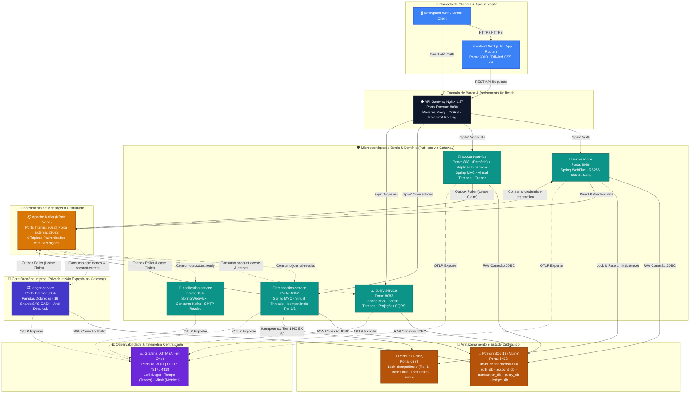
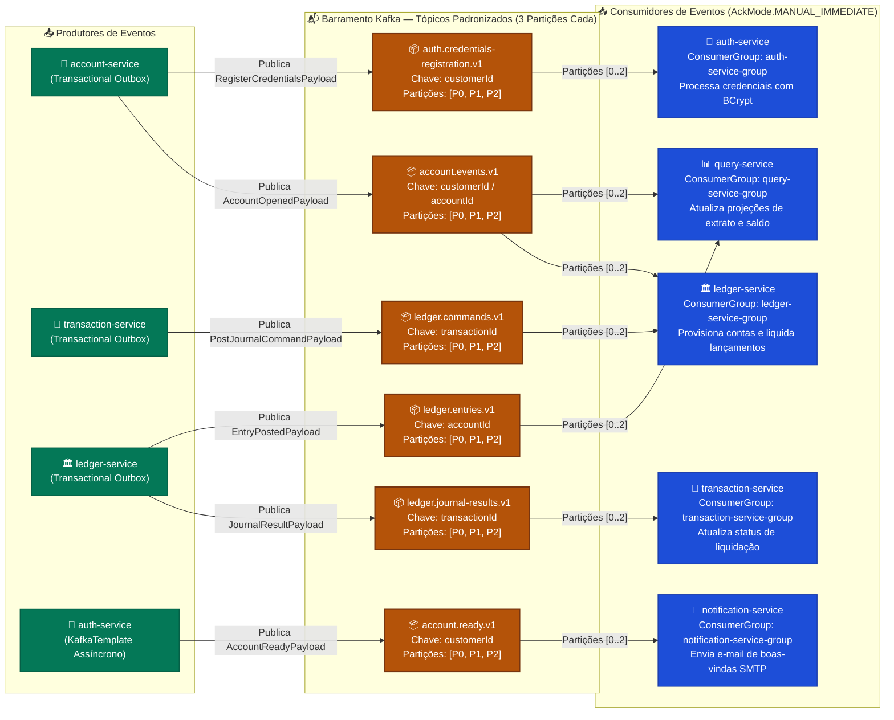
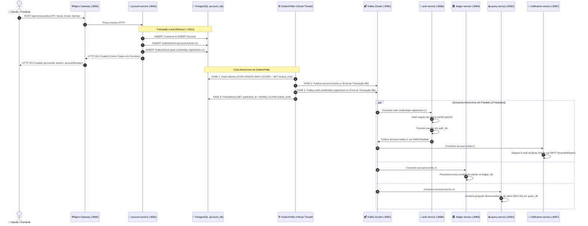
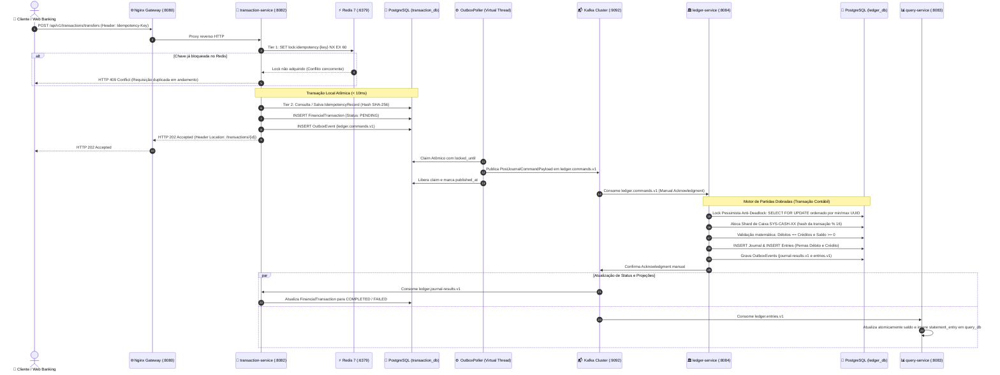
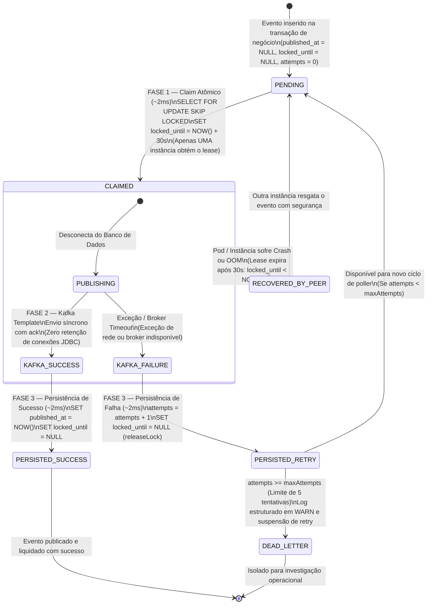

# Bank Ledger — Arquitetura Consolidada do Sistema

> **Documento Consolidado de Referência Técnica & Contexto para IA e Engenheiros**  
> *Versão:* 3.0 (Atualizado pós-lease-based outbox, escalabilidade horizontal com réplicas e SMTP condicional)  
> *Data de Consolidação:* Novembro de 2026

---

## 1. Visão Geral e Propósito do Projeto

O **Bank Ledger** é uma plataforma de **Core Bancário** (Ledger) desenhada para processamento financeiro corporativo de missão crítica (Nexus Bank). O sistema foi concebido para suportar altíssima concorrência com consistência matemática absoluta, eliminando por completo a possibilidade de inconsistência contábil, perda de dados ou saldos negativos em contas de clientes.

### Princípios Fundamentais de Domínio:
1. **Partidas Dobradas (Double-Entry Accounting):** Toda movimentação financeira é composta por pernas simétricas de débito e crédito que somam rigorosamente zero (`Total Débitos = Total Créditos`). Não existem saldos isolados ou transações unilaterais.
2. **Moeda e Precisão Monetária:** Apenas moeda BRL, com valores estritamente modelados como números inteiros em centavos (`Long`/`bigint`). **É proibido o uso de números de ponto flutuante (`float`/`double`)** para valores monetários.
3. **Consistência Eventual e Event-Driven Architecture:** Abertura de conta, provisionamento de credenciais e notificações operam de forma 100% assíncrona orientada a eventos via Apache Kafka, eliminando chamadas HTTP bloqueantes dentro de transações de banco.
4. **Idempotência Estrita de Dois Níveis:** Todas as operações mutáveis exigem o cabeçalho `Idempotency-Key` (UUIDv4), protegido por bloqueio em memória no Redis (Tier 1) e armazenamento definitivo no PostgreSQL (Tier 2).
5. **Autenticação Descentralizada:** Autenticação centralizada no `auth-service`, com emissão de JWTs assinados via RS256 e validação matemática local descentralizada nos demais microsserviços através de JWKS (RFC 7517) em memória.

---

## 2. Stack Tecnológica e Versões Oficiais

| Camada / Componente | Tecnologia | Versão | Função no Ecossistema |
| :--- | :--- | :--- | :--- |
| **Linguagem & Runtime** | Java OpenJDK (Virtual Threads ativas) | **25** | Execução de alta vazão no backend com I/O não bloqueante |
| **Framework Backend** | Spring Boot | **4.1.2** | Spring Framework 7, starters modulares, Jackson 3 |
| **Serialização JSON** | Jackson 3 (`tools.jackson`) | **3.1.7** | Deserialização estritamente tipada com envelopes CloudEvents (sem `JsonNode`) |
| **Build & Monorepo** | Gradle (Groovy DSL) | **9.x** | Gestão de dependências e automação de builds multi-serviço |
| **Banco de Dados** | PostgreSQL | **18 (Alpine)** | Bancos dedicados por serviço (*Database-per-Service*) |
| **Pool de Conexões** | HikariCP | Gerenciado | Sintonizado para alta concorrência: `max: 30`, `min: 10` |
| **Cache & In-Memory Lock**| Redis (com driver Lettuce Reativo) | **7 (Alpine)** | Rate limiting dinâmico (20 TPS) e lock de brute-force |
| **Mensageria** | Apache Kafka (KRaft mode) | **8.4.0** | Barramento de eventos assíncronos duráveis com 3 partições |
| **API Gateway** | Nginx | **1.27** | Ponto único de entrada na porta 8080 com CORS configurado |
| **Observabilidade** | OpenTelemetry + Grafana LGTM | All-in-One | Loki (Logs), Tempo (Traces), Mimir (Métricas), Grafana na porta 3001 |
| **Testes de Integração** | Testcontainers (PostgreSQL & Kafka) | **1.20.4** | Versão padronizada e centralizada em todos os módulos para testes de integração |
| **Frontend Web** | Next.js (App Router / TypeScript) | **16.4.3** | Interface web de Web Banking (Tailwind CSS v4) na porta 3000 |

---

## 3. Topologia e Mapa dos Microsserviços

O ecossistema é composto por 6 microsserviços autônomos, 1 biblioteca comum compartilhada e 1 frontend web, orquestrados com separação estrita de domínios, banco de dados dedicado por serviço (*Database-per-Service*) e barramento assíncrono de eventos distribuídos via Apache Kafka (KRaft).

---

### 3.1 Visão Geral e Topologia de Infraestrutura (C4 Nível 2)

O diagrama abaixo ilustra a topologia física e lógica dos nós, a fronteira de borda gerenciada pelo API Gateway Nginx, o isolamento dos bancos de dados e a malha de telemetria unificada:



---

### 3.2 Topologia de Mensageria e Barramento Kafka (Event-Driven Architecture)

O diagrama a seguir detalha a matriz de integração assíncrona orientada a eventos. Todos os tópicos são padronizados com **3 partições** e consumidos com **concorrência balanceada (`concurrency = "3"`)** e **`AckMode.MANUAL_IMMEDIATE`**, garantindo vazão paralela e ordenação estrita por chave de entidade (*Partition Key*):



---

### 3.3 Diagrama de Sequência: Saga Coreografada de Abertura de Conta

A abertura de conta adota o princípio de **latência ultra-baixa na borda (< 10ms)** com desacoplamento total da criação de credenciais, provisionamento contábil e disparo de e-mails:



---

### 3.4 Diagrama de Sequência: Movimentação Financeira e Partidas Dobradas

Garantia de consistência estrita, idempotência de dois níveis, prevenção de deadlocks e alocação dinâmica em shards contábeis:



---

### 3.5 Ciclo de Vida do Transactional Outbox com Lease-Based Claiming Multi-Instância

Para viabilizar a **execução horizontal com múltiplas réplicas** do mesmo microsserviço (ex: instâncias primárias e secundárias do `account-service`), o `OutboxPoller` utiliza um protocolo de **3 Fases com Lease Atômico (`locked_until`)**:



---

### 3.6 Detalhamento por Microsserviço

#### 1. `auth-service` (Porta 8086)
- **Tipo:** Reativo (Spring WebFlux + Netty).
- **Responsabilidades:**
  - Emissão de tokens JWT assimétricos (RS256, 2048-bit) com Key ID (`kid`) e endpoint público de chaves `GET /api/v1/auth/jwks.json` (RFC 7517).
  - Rotação de *Refresh Tokens* opacos e reutilização inteligente de tokens ativos com TTL dinâmico.
  - Criptografia de senhas rápida e resiliente exclusivamente via **BCrypt(10)**.
  - **Lock de Contas no Redis:** Chaves `auth:failed_attempts:{cpf}` e `auth:lock:{cpf}` (TTL 15 min). A validação de bloqueio ocorre no Redis **antes** de tocar no banco de dados, protegendo o PostgreSQL e o CPU contra ataques de força bruta.
  - **Rate Limiting Dinâmico a 20 TPS:** `RateLimitingWebFilter` reativo no Redis. Endpoint `PUT /internal/auth/ratelimit` com payload `{"tps": 20}` para reconfiguração dinâmica em testes locais.
  - **Endpoint Reativo de Alto Tráfego:** `GET /internal/auth/users/{customerId}` e `by-cpf/{cpf}` protegido por `X-Internal-Service-Key`, retornando `AuthUserSummaryResponse` sanitizado (zero senhas, zero contadores).
  - **Integração Kafka & Consumo Assíncrono:** Utiliza `spring-boot-starter-kafka`, `@EnableKafka` e container factory customizado com `AckMode.MANUAL_IMMEDIATE`. Consome `auth.credentials-registration.v1` via `RegisterCredentialsKafkaConsumer` (suportando tanto `KafkaEventEnvelope<RegisterCredentialsPayload>` quanto payload plano) e publica `AccountReadyEvent` via `KafkaAccountReadyEventPublisher` (`KafkaTemplate<String, String>`).

#### 2. `account-service` (Porta 8081)
- **Tipo:** Spring Boot MVC com Virtual Threads ativas.
- **Responsabilidades:**
  - Gestão de clientes (`Customer`), documentos (CPF com validação Módulo 11 estrita) e contas (`Account`).
  - **Abertura de Conta 100% Assíncrona:** O método `createAccount` persiste `Customer`, `Account` e dois registros de Outbox atômicos em **< 10ms**, devolvendo a conexão JDBC ao pool imediatamente. Zero chamadas síncronas HTTP bloqueando o banco.
  - Publica `AccountOpened` em `account.events.v1` e credenciais em `auth.credentials-registration.v1` via Outbox Poller.
  - **Escalabilidade Horizontal Multi-Instância:** Suporta execução de múltiplas instâncias simultâneas (1 primária na porta fixa 8081 + N réplicas em portas dinâmicas sob o alias de rede Docker `account-service`). A concorrência entre os pollers de cada instância é protegida pelo mecanismo de lease atômico (`locked_until`), garantindo que apenas uma instância reivindique e publique cada evento no Kafka, sem mensagens duplicadas.

#### 3. `transaction-service` (Porta 8082)
- **Tipo:** Spring Boot MVC com Virtual Threads ativas.
- **Responsabilidades:**
  - Ponto de entrada de depósitos, saques e transferências entre contas bancárias.
  - **Idempotência em Dois Níveis:**
    - *Tier 1 (Redis):* Lock atômico `SET lock:idempotency:{key} {worker} NX EX 60` para rejeição instantânea de requisições concorrentes idênticas (`409 Conflict`).
    - *Tier 2 (PostgreSQL):* Registro durável com hash SHA-256 do payload, status e resposta original para repetições legítimas (*replay*).
  - Responde imediatamente HTTP `202 Accepted` com cabeçalho `Location` para polling/acompanhamento.
  - Comunicação com o core contábil via tópico `ledger.commands.v1` e consumo da confirmação em `ledger.journal-results.v1`.

#### 4. `ledger-service` (Porta 8084 - Core Interno)
- **Tipo:** Spring Boot MVC com Virtual Threads ativas (sem exposição externa no Gateway).
- **Responsabilidades:**
  - Motor de Partidas Dobradas (Double-Entry Engine): gravação atômica e imutável de `Journal` e pernas de `Entry` (débitos e créditos).
  - **Alocação Híbrida de Shards de Caixa (`SYS-CASH`):** 16 shards de caixa (`SYS-CASH-00` a `SYS-CASH-15`) para distribuir o lock de concorrência em depósitos e saques (por terminal físico ou hash determinístico `hash(transactionId) % 16`).
  - **Lock Pessimista Anti-Deadlock:** `SELECT ... FOR UPDATE` ordenando os IDs de contas deterministicamente por UUID (`min(idA, idB)` antes de `max(idA, idB)`).
  - Segurança de microsserviço interno via validação do header `X-Internal-Service-Key`.

#### 5. `query-service` (Porta 8083)
- **Tipo:** Projeções de Leitura CQRS.
- **Responsabilidades:**
  - Projeções desnormalizadas de saldo (`account_balance`) e extrato oficial (`statement_entries`) persistidas no `query_db`.
  - Ingestão contínua de eventos via Kafka (`account.events.v1` e `ledger.entries.v1`).
  - **Mitigação Estrita de BOLA/IDOR:** Validação de que o usuário autenticado no JWT é o titular da conta consultada (ou perfil `ROLE_ADMIN`), retornando `403 Forbidden` com RFC 7807 ProblemDetail em caso de tentativa de acesso a conta alheia.

#### 6. `notification-service` (Porta 8087)
- **Tipo:** Full Reativo (Spring WebFlux + Netty).
- **Responsabilidades:**
  - Consumo assíncrono do tópico `account.ready.v1` através de listener Kafka fortemente tipado (sem `JsonNode`).
  - **Design sem Banco de Dados:** Exclusão explícita de autoconfigurações JPA e DataSource (`DataSourceAutoConfiguration`, `DataSourceTransactionManagerAutoConfiguration`, `HibernateJpaAutoConfiguration`).
  - **Telemetria OpenTelemetry (OTLP):** Exporta métricas, traces e logs para o coletor `otel-lgtm:4318`.
  - **Bean Condicional de SMTP (`MailConfiguration`):** O `JavaMailSender` só é instanciado quando `app.mail.enabled=true` via `@ConditionalOnProperty`. O `EmailNotificationService` injeta `Optional<JavaMailSender>`, prevenindo alertas de falha no health indicator do Actuator quando o serviço de e-mail estiver desabilitado.
  - Envio de e-mails de boas-vindas via Google SMTP (`smtp.gmail.com:587`, TLS) isolando o I/O bloqueante do `JavaMailSender` no `Schedulers.boundedElastic()`.
  - **Feature Flag de Carga:** `app.mail.enabled: ${MAIL_ENABLED:false}` (default desativado no Docker Compose para testes locais e de carga). Quando desativada, registra o log estruturado do envio sem disparar chamadas SMTP, permitindo testes de carga com 500+ threads com zero dependência externa.

#### 7. `platform-commons`
- **Biblioteca compartilhada interna (`services/platform-commons`)**:
  - `KafkaEventEnvelope<T>`: Envelope CloudEvents 1.0 reutilizável para serialização/deserialização Jackson 3 tipada.
  - `SecurityConstants` & `HttpHeaderConstants`: Centralização de cabeçalhos (`X-Internal-Service-Key`, `Idempotency-Key`, `Authorization`), constantes de retry reativo (3 tentativas, 50ms) e endpoints protegidos.
  - `InboxHandler`: Controle de idempotência de consumo no banco de dados local para garantir semântica *exactly-once*.
  - `OutboxEvent` & `OutboxPoller`: Mecanismo transacional de Outbox com lease atômico distribuído (`locked_until`). Ciclo em 3 fases (Claim atômico via `FOR UPDATE SKIP LOCKED` -> Envio Kafka fora de transação DB -> Persistência de estado com liberação de lock). Suporte a fallback de auto-resgate (expiração de lease de 30s) e contagem de tentativas (`maxAttempts: 5`).
  - Records canônicos de domínio e DTOs de eventos (`AccountOpenedPayload`, `AccountReadyPayload`, `PostJournalCommandPayload`, `JournalPostedPayload`, `JournalRejectedPayload`, `EntryPostedPayload`, `RegisterCredentialsPayload`).

---

## 4. Mapa Completo de Arquivos e Estrutura de Diretórios (Guia para IA e Desenvolvedores)

Para facilitar a navegação autônoma por agentes de IA e engenheiros de software, abaixo está o mapa detalhado de diretórios e arquivos do repositório, identificando a finalidade técnica de cada componente:

```text
bank-ledger/
├── api-contracts/                     # Contratos OpenAPI 3.0 (YAML) de cada microsserviço
│   ├── account-service.yaml           # Endpoints de criação de conta e dados do cliente
│   ├── auth-service.yaml              # Endpoints de autenticação, JWKS e rate-limiting
│   ├── ledger-service.yaml            # Contrato contábil interno (lançamento de journals e balancete)
│   ├── query-service.yaml             # Contrato de consultas CQRS (saldo e extrato)
│   └── transaction-service.yaml       # Contrato de depósitos, saques e transferências
│
├── design/                            # Especificações funcionais, protótipos visuais e design de telas
│   ├── institutional_ledger_core_banking/DESIGN.md # Documento de design do core bancário
│   ├── nexus_bank_abrir_conta/        # Mockups e HTML da jornada de abertura de conta
│   ├── nexus_bank_login/              # Mockups e HTML da jornada de autenticação
│   ├── web_banking_depositar_sacar/   # Mockups das operações de caixa
│   ├── web_banking_extrato_banc_rio_completo/ # Mockups do extrato financeiro
│   ├── web_banking_transfer_ncia_entre_contas/ # Mockups de transferência segura
│   └── web_banking_vis_o_geral_saldo/ # Mockups da dashboard de visão geral
│
├── docs/                              # Documentação viva e consolidada do projeto
│   ├── ARQUITETURA_CONSOLIDADA.md     # Documento mestre: padrões, topologia, stack e diretrizes
│   └── SUGESTOES_DE_MELHORIAS.md      # Roadmap de evolução técnica (CDC Debezium, R2DBC, MFA, Pix)
│
├── infra/                             # Orquestração e infraestrutura local (Docker)
│   └── docker/
│       ├── docker-compose.yml         # Stack com 13 containers (Postgres, Redis, Kafka KRaft, OTel, Gateway, Web)
│       ├── nginx/
│       │   └── nginx.conf             # API Gateway unificado (porta 8080) com CORS e roteamento reverso
│       └── postgres/
│           └── init-databases.sql     # Script SQL que provisiona os 5 bancos isolados por serviço
│
├── load-tests/                        # Ferramenta autônoma de teste de carga em Node.js puro (zero k6/JMeter)
│   ├── package.json                   # Dependência única: @faker-js/faker
│   ├── README.md                      # Instruções de benchmark e parametrização
│   ├── run.js                         # CLI executável (-c concorrência, -n requisições, -u URL)
│   ├── src/
│   │   ├── cli.js                     # Parser de argumentos CLI e help interativo
│   │   ├── cpf.js                     # Algoritmo Módulo 11 para geração de CPF válido
│   │   ├── generator.js               # Gerador sintético de dados bancários (idade >= 18 anos)
│   │   ├── metrics.js                 # Coleta e cálculo de percentis de latência (p50, p90, p95, p99)
│   │   └── runner.js                  # Pool concorrente assíncrono de chamadas HTTP fetch nativas
│   └── tests/                         # Suíte de testes do próprio framework de carga
│
├── services/                          # Monorepo Backend multi-módulo Gradle em Java 25 & Spring Boot 4.1.2
│   ├── build.gradle                   # Configurações raiz do Gradle e dependências globais
│   ├── settings.gradle                # Registro dos 7 projetos Java integrados
│   ├── gradlew / gradlew.bat          # Wrapper oficial do Gradle 9.x
│   │
│   ├── platform-commons/              # Biblioteca compartilhada interna entre os microsserviços
│   │   ├── build.gradle
│   │   └── src/main/java/com/bankledger/commons/
│   │       ├── constant/              # BankingConstants, BankingErrorCodes, KafkaTopics, HttpHeaderConstants
│   │       ├── domain/event/          # EventEnvelope genérico e metadados
│   │       ├── events/                # KafkaEventEnvelope<T> (CloudEvents 1.0 com Jackson 3)
│   │       │   └── v1/
│   │       │       ├── account/       # AccountOpenedPayload, AccountReadyPayload
│   │       │       └── ledger/        # PostJournalCommandPayload, JournalPostedPayload, JournalRejectedPayload, EntryPostedPayload
│   │       ├── inbox/                 # InboxEvent, InboxEventRepository, InboxHandler (idempotência exatamente-uma-vez)
│   │       ├── outbox/                # OutboxEvent, OutboxEventRepository, OutboxPoller, OutboxPublisher
│   │       ├── observability/         # Auto-configuração OTLP e enriquecimento MDC para logs
│   │       └── security/              # TokenClaims, RsaJwtSigner, RsaJwtValidator, JwksPublicKeyProvider, RegisterCredentialsPayload
│   │
│   ├── auth-service/                  # Microsserviço Reativo de Autenticação, Tokens e Segurança (Porta 8086)
│   │   ├── build.gradle               # WebFlux, Data JPA, Redis Reactive, Starter Kafka, Flyway, BouncyCastle
│   │   ├── Dockerfile                 # Multi-stage Temurin 25 JDK -> JRE Alpine
│   │   └── src/main/
│   │       ├── java/com/bankledger/auth/
│   │       │   ├── AuthServiceApplication.java # @EnableKafka e exclusão de UserDetails autoconfig
│   │       │   ├── config/            # JwtSignerConfig, KafkaConfig (AckMode.MANUAL_IMMEDIATE), RateLimitingWebFilter, SecurityConfig
│   │       │   ├── domain/            # AuthUser, AccountReadyEvent, exceções (InvalidCredentials, CustomerLocked)
│   │       │   ├── application/       # Portas de entrada/saída e AuthService (login, jwks, registerCredentials)
│   │       │   └── adapters/
│   │       │       ├── in/rest/       # AuthController (login, refresh, jwks), InternalAuthController (introspect, rate-limit, lookup)
│   │       │       ├── in/kafka/      # RegisterCredentialsKafkaConsumer (consumo assíncrono de auth.credentials-registration.v1)
│   │       │       ├── out/persistence/# AuthUserEntity, AuthUserRepository, AuthUserPersistenceAdapter
│   │       │       ├── out/redis/     # RedisAccountLockoutAdapter (lock de brute-force e rate-limiting no Redis)
│   │       │       ├── out/security/  # BCryptPasswordEncoderAdapter (BCrypt 10)
│   │       │       └── out/kafka/     # KafkaAccountReadyEventPublisher (publica account.ready.v1 via KafkaTemplate)
│   │       └── resources/
│   │           ├── application.yml
│   │           └── db/migration/V1__init_auth_schema.sql
│   │
│   ├── account-service/               # Microsserviço de Clientes & Contas Bancárias (Porta 8081)
│   │   ├── build.gradle               # MVC, Virtual Threads, Starter Kafka, Flyway, HikariCP (30/10)
│   │   ├── Dockerfile
│   │   └── src/main/
│   │       ├── java/com/bankledger/account/
│   │       │   ├── AccountServiceApplication.java
│   │       │   ├── config/            # KafkaConfig, OpenApiConfig, OutboxPollerProperties, SecurityConfig
│   │       │   ├── domain/            # Account, Customer, AccountStatus, VOs (Cpf Módulo 11, Email, Phone, AccountNumber)
│   │       │   ├── application/       # CreateAccountService (abertura atômica < 10ms), AccountQueryService
│   │       │   └── adapters/
│   │       │       ├── in/rest/       # AccountController (POST /api/v1/accounts, GET /me, GET /lookup)
│   │       │       ├── out/persistence/# AccountEntity, CustomerEntity, OutboxPersistenceAdapter
│   │       │       └── out/kafka/     # KafkaOutboxPublisher, OutboxPollerLifecycle
│   │       └── resources/
│   │           ├── application.yml
│   │           └── db/migration/V1__init_account_schema.sql
│   │
│   ├── transaction-service/           # Microsserviço de Movimentações Financeiras (Porta 8082)
│   │   ├── build.gradle               # MVC, Virtual Threads, Starter Kafka, Flyway, HikariCP (30/10)
│   │   ├── Dockerfile
│   │   └── src/main/
│   │       ├── java/com/bankledger/transaction/
│   │       │   ├── TransactionServiceApplication.java
│   │       │   ├── config/            # KafkaConfig, SecurityConfig, OutboxPollerProperties
│   │       │   ├── domain/            # FinancialTransaction, IdempotencyRecord, PostJournalCommand
│   │       │   ├── application/       # CreateTransferService, TransactionOperationService, IdempotencyValidatorService
│   │       │   └── adapters/
│   │       │       ├── in/rest/       # TransactionController (endpoints 202 Accepted de transferências, depósitos, saques)
│   │       │       ├── in/kafka/      # JournalResultKafkaConsumer (recebe resposta do Ledger)
│   │       │       ├── out/persistence/# IdempotencyPersistenceAdapter (Tier 2), TransactionPersistenceAdapter
│   │       │       └── out/kafka/     # KafkaOutboxPublisher (envia ledger.commands.v1)
│   │       └── resources/
│   │           ├── application.yml
│   │           └── db/migration/V1__init_transaction_schema.sql
│   │
│   ├── ledger-service/                # Core Bancário de Partidas Dobradas (Porta 8084 - Interno e Privado)
│   │   ├── build.gradle               # MVC, Virtual Threads, Starter Kafka, Flyway, HikariCP (30/10)
│   │   ├── Dockerfile
│   │   └── src/main/
│   │       ├── java/com/bankledger/ledger/
│   │       │   ├── LedgerServiceApplication.java
│   │       │   ├── config/            # CashShardConfig (16 shards SYS-CASH), SecurityConfig
│   │       │   ├── domain/            # Journal, Entry, LedgerAccount, AccountKind, NormalBalance, TrialBalanceTotals
│   │       │   ├── application/       # PostJournalService, ProvisionAccountService, PostingStrategies (Deposit, Withdrawal, Transfer)
│   │       │   └── adapters/
│   │       │       ├── in/rest/       # InternalLedgerController (balancete e consultas protegidas por X-Internal-Service-Key)
│   │       │       ├── in/kafka/      # AccountOpenedKafkaConsumer, LedgerCommandKafkaConsumer
│   │       │       ├── out/cache/     # CashShardCache (cache em memória das contas de caixa)
│   │       │       ├── out/persistence/# JournalEntity, EntryEntity, LedgerAccountEntity
│   │       │       └── out/kafka/     # KafkaOutboxPublisher (publica journal-results e entries)
│   │       └── resources/
│   │           ├── application.yml
│   │           └── db/migration/V1__init_ledger_schema.sql
│   │
│   ├── query-service/                 # Microsserviço de Leitura CQRS & Extrato (Porta 8083)
│   │   ├── build.gradle               # MVC, Virtual Threads, Starter Kafka, Flyway, HikariCP (30/10)
│   │   ├── Dockerfile
│   │   └── src/main/
│   │       ├── java/com/bankledger/query/
│   │       │   ├── QueryServiceApplication.java
│   │       │   ├── config/            # SecurityConfig com mitigação estrita de BOLA/IDOR
│   │       │   ├── domain/            # AccountBalance, StatementEntry (modelos de leitura desnormalizados)
│   │       │   └── adapters/
│   │       │       ├── in/rest/       # QueryController (GET /api/v1/queries/balance e /statement)
│   │       │       ├── in/kafka/      # QueryEventConsumer (ingestão contínua de account.events e ledger.entries)
│   │       │       └── out/persistence/# AccountBalanceEntity, StatementEntryEntity
│   │       └── resources/
│   │           ├── application.yml
│   │           └── db/migration/V1__init_query_schema.sql
│   │
│   └── notification-service/          # Microsserviço de Notificações & E-mail (Porta 8087)
│       ├── build.gradle               # WebFlux, Starter Mail, Starter Kafka, Starter Actuator
│       ├── Dockerfile                 # Multi-stage Temurin 25 Alpine
│       └── src/main/
│           ├── java/com/bankledger/notification/
│           │   ├── NotificationServiceApplication.java  # Exclusão de autoconfigurações JPA/DataSource
│           │   ├── adapters/in/kafka/ # AccountReadyKafkaConsumer (escuta account.ready.v1)
│           │   └── application/service/# EmailNotificationService (envio SMTP assíncrono com feature flag)
│           └── resources/
│               └── application.yml    # Configurações de SMTP, Kafka e exportação OTLP
│
└── web/                               # Aplicação Frontend Web Banking (Next.js 16 / TypeScript / Tailwind CSS v4)
    ├── package.json                   # Next.js 16.4.3, React 19, Lucide React, Tailwind CSS v4
    ├── Dockerfile                     # Multi-stage Node Alpine otimizado para produção
    ├── next.config.ts
    ├── src/
    │   ├── app/                       # Next.js App Router
    │   │   ├── page.tsx               # Landing Page institucional Nexus Bank
    │   │   ├── login/page.tsx         # Tela de Login com autenticação JWT
    │   │   ├── signup/page.tsx        # Tela de Abertura de Conta (stepper guiado com validação CPF)
    │   │   └── dashboard/             # Área logada do cliente
    │   │       ├── page.tsx           # Visão Geral: saldo em tempo real e atalhos rápidos
    │   │       ├── operations/page.tsx# Depósitos e saques simulados
    │   │       ├── statement/page.tsx # Extrato Bancário com filtros e exportação CSV
    │   │       └── transfer/page.tsx  # Transferência entre contas com confirmação segura
    │   ├── components/                # Componentes visuais modulares
    │   │   ├── banking/               # AuthGuard, BankingHeader, BankingFooter
    │   │   ├── forms/                 # OpenAccountForm
    │   │   ├── landing/               # HeroSection, CoreFeatures, OmnichannelSection, Simulator
    │   │   └── ui/                    # CpfInput, Stepper, NexusBlackCard, NexusBlackCardPreview
    │   ├── hooks/                     # useBanking (gerenciamento centralizado de autenticação e contas)
    │   ├── services/                  # Clientes de API (authService, accountService, transactionService, queryService)
    │   └── utils/                     # Utilitários de formatação (cpf, currency, date, exportStatement, uuid)
```

---

## 5. Padrões de Código e Diretrizes Arquiteturais (Regras de Ouro)

Qualquer IA, desenvolvedor ou agente autônomo que continuar o desenvolvimento deste projeto **DEVE** seguir rigorosamente estes padrões:

### 5.1 Arquitetura Hexagonal (Ports & Adapters)
- **Camada de Domínio (`domain`):** Pure Java POJOs/Records e exceções de domínio. **Zero dependências de frameworks** (proibido importar Spring, Hibernate, JPA ou Jackson em modelos e regras de negócio puras).
- **Camada de Aplicação (`application`):** Casos de uso (`*UseCase`), portas de entrada (`port.in`), portas de saída (`port.out`) e orquestração de serviços de aplicação.
- **Camada de Adaptadores (`adapters`):**
  - `adapters.in.rest`: Controllers REST, WebFilters e DTOs de entrada/saída.
  - `adapters.in.kafka`: Consumidores de mensageria com Acknowledgment manual.
  - `adapters.out.persistence`: Entidades JPA, Repositórios Spring Data e Mappers.
  - `adapters.out.kafka`: Produtores de eventos e adaptadores de publicação.
  - `adapters.out.redis`: Adaptadores de lock, cache e limitação de taxa.

### 5.2 Mensageria Kafka: Proibição Estrita de `JsonNode`
- **Regra:** Nunca utilizar `JsonNode`, `ObjectNode`, `readTree`, `treeToValue` ou `node.path(...)` em consumidores Kafka.
- **Padrão Obrigatório:** Utilizar sempre a desserialização tipada direta do Jackson 3 (`ObjectMapper.readValue`) com o envelope genérico:
  ```java
  KafkaEventEnvelope<MyPayload> envelope = objectMapper.readValue(
      record.value(),
      new TypeReference<KafkaEventEnvelope<MyPayload>>() {}
  );
  MyPayload payload = envelope.data() != null ? envelope.data() : objectMapper.readValue(record.value(), MyPayload.class);
  ```
- **Mapeamento Prévio:** Todos os atributos devem ser validados e convertidos para DTOs/Records fortemente tipados **antes** de acionar o `InboxHandler` ou o caso de uso de aplicação.
- **Configuração de Listeners e AckMode:**
  - Todo microsserviço que consome Kafka deve obrigatoriamente incluir `org.springframework.boot:spring-boot-starter-kafka`, a anotação `@EnableKafka` e registrar um `ConcurrentKafkaListenerContainerFactory` com `AckMode.MANUAL_IMMEDIATE` quando o método consumidor utilizar `Acknowledgment` manual para confirmação transacional da mensagem.

### 5.3 Banco de Dados e Conexões (PostgreSQL & HikariCP)
- **Tamanho dos Pools nos Microsserviços:** Todos os microsserviços utilizam o pool dimensionado para:
  ```yaml
  spring:
    datasource:
      hikari:
        maximum-pool-size: 30
        minimum-idle: 10
        connection-timeout: 30000
        leak-detection-threshold: 10000
  ```
- **Capacidade do PostgreSQL (`max_connections = 300`):**
  - O PostgreSQL possui por padrão um limite de 100 conexões concorrentes.
  - Como o Bank Ledger possui 5 microsserviços com `maximum-pool-size: 30`, a soma teórica de conexões simultâneas chega a 150 (mais conexões de migração Flyway e monitoramento).
  - Sob cargas de estresse (ex: 50.000 requisições simultâneas), um limite de 100 conexões causa esgotamento (*FATAL: sorry, too many clients already*).
  - O PostgreSQL no `docker-compose.yml` é configurado explicitamente com `-c max_connections=300` e parâmetros otimizados de buffer/WAL (`shared_buffers=256MB`, `effective_cache_size=768MB`, `work_mem=16MB`, `maintenance_work_mem=64MB`).
- **Desacoplamento de I/O de Rede e Protocolo em 3 Fases com Lease Atômico no Outbox:**
  - O Transactional Outbox (`OutboxPoller`) opera em um ciclo estrito de **3 fases** desacopladas para garantir zero duplicação entre réplicas e proteção total do pool HikariCP:
    1. **Fase 1 — Claim Atômico com Lease (Transação DB ultrarrápida < 2ms):** Executa `SELECT * FROM outbox_event WHERE published_at IS NULL AND (locked_until IS NULL OR locked_until < :now) AND attempts < :maxAttempts ORDER BY created_at ASC LIMIT :batchSize FOR UPDATE SKIP LOCKED`. Na mesma transação, atualiza `locked_until = now + 30s` e commita. O `FOR UPDATE SKIP LOCKED` distribui os lotes sem contenção, enquanto o timestamp `locked_until` atua como **lease distribuído**, impedindo que qualquer outra instância processe os mesmos registros enquanto o claim estiver vigente.
    2. **Fase 2 — Publicação Kafka (Sem retenção de transação DB):** O envio dos eventos ao cluster Kafka é realizado **fora de qualquer transação de banco de dados**. Isso previne travamentos no pool HikariCP e elimina alertas de *connection leak detection* durante eventuais oscilações ou latências de rede do broker.
    3. **Fase 3 — Persistência e Liberação de Lease (Transação DB ultrarrápida < 2ms):** Se a publicação for bem-sucedida, invoca `markPublished()` (grava `published_at = NOW()` e limpa `locked_until`). Em caso de falha de publicação (ex: timeout do Kafka), invoca `markFailed()` (`attempts++`) e `releaseLock()` (limpa `locked_until`), permitindo retry imediato.
  - **Mecanismo de Auto-Resgate em Falhas Graves:** Caso um container ou pod sofra *Crash*, *OOMKilled* ou travamento fatal durante a Fase 2, o lease expira automaticamente após 30 segundos (`locked_until < NOW()`). Instâncias irmãs ou a própria instância recuperada resgatam os eventos pendentes sem necessidade de intervenção manual ou scripts de reconciliação.
- **Proibição de I/O Externo em Transações:** **É terminantemente proibido realizar chamadas HTTP de rede ou esperas longas dentro de métodos anotados com `@Transactional`**. Transações devem durar menos de 10ms. Comunicação entre serviços deve ser assíncrona via Outbox no Kafka.

### 5.4 Autenticação e Segurança
- **Assinatura e Validação:** Assinatura RS256 centralizada no `auth-service` e validação descentralizada nos Resource Servers via cache de chaves públicas do JWKS.
- **Tratamento de Erros:** Todos os erros de segurança (401 Unauthorized, 403 Forbidden, 429 Too Many Requests) retornam o padrão corporativo **RFC 7807 ProblemDetail**.
- **Serviços Internos:** Endpoints internos de infraestrutura (ex: chamadas ao `ledger-service` ou consultas de resumo no `auth-service`) utilizam autenticação por chave de serviço via header `X-Internal-Service-Key`.

### 5.5 Injeção de Dependências: Construtores com Lombok (@RequiredArgsConstructor) e Proibição Estrita de @Autowired
- **Regra Obrigatória:** Em **todos os projetos e microsserviços do Bank Ledger**, a injeção de dependências em componentes gerenciados pelo Spring (`@Service`, `@Component`, `@Controller`, etc.) **DEVE** utilizar construtor gerado automaticamente pelo **Lombok** através da anotação `@RequiredArgsConstructor`.
- **Proibição Estrita de `@Autowired`:** É expressamente **proibido** utilizar a anotação `@Autowired` em construtores ou sobre atributos (`field injection`). O Spring Framework injeta automaticamente as dependências quando existe um único construtor público na classe, tornando `@Autowired` redundante e propenso a falhas de ambiguidade de beans.
- **Imutabilidade (`private final`):** Todas as dependências a serem injetadas devem ser declaradas como `private final`.
- **Propriedades e Configurações (`@ConfigurationProperties`):**
  - **Proibição de `@Value` solto em construtores:** Não utilize anotações `@Value` diretamente em parâmetros de construtores de serviços ou múltiplos construtores sobrecarregados.
  - **Padrão Oficial:** Encapsule propriedades em classes de configuração dedicadas anotadas com `@ConfigurationProperties` e `@Component` (utilizando `@Getter` e `@Setter` do Lombok), por exemplo `EmailNotificationProperties` ou `OutboxPollerProperties`, injetando a classe de propriedades como `private final` no serviço via `@RequiredArgsConstructor`.
- **Testabilidade:** Em testes unitários, instancie os serviços diretamente passando os mocks e a instância das propriedades no construtor gerado pelo Lombok, sem depender do runner de injeção de contexto quando não for teste de integração.

### 5.6 Project Reactor & Virtual Threads (Java 21+)
- **Regra:** O `Schedulers.boundedElastic()` do Project Reactor (utilizado no Spring WebFlux e operações assíncronas do ecossistema) **DEVE** utilizar Virtual Threads do Java para garantir máxima escalabilidade e evitar saturação de threads nativas do sistema operacional.
- **Configuração Obrigatória da JVM:**
  - Propriedade de sistema: `reactor.schedulers.defaultBoundedElasticOnVirtualThreads=true`.
  - **Auto-configuração:** Implementada via `ReactorVirtualThreadsEnvironmentPostProcessor` no `platform-commons` (`HIGHEST_PRECEDENCE`), garantindo ativação automática no início do ciclo de vida do Spring Boot.
  - **Garantia de Inicialização Precoce:** Declarada no bloco `static {}` e no método `main()` de todos os pontos de entrada `*Application.java`.
  - **Ambiente de Teste e Execução:** Configurada nas tarefas `Test` e `JavaExec` no `build.gradle` multi-projeto.
  - **Contêineres Docker:** Incluída no `ENTRYPOINT` de todos os `Dockerfile` e via variável `JAVA_TOOL_OPTIONS` no `docker-compose.yml`.

### 5.7 Padrão Unificado de Logs para Observabilidade no Grafana / Loki
- **Objetivo:** Facilitar a busca e filtragem no Grafana (Loki) e exportação OpenTelemetry ao visualizar streams agregados de todos os microsserviços do Bank Ledger.
- **Estrutura do Padrão (`CONSOLE_LOG_PATTERN` e `FILE_LOG_PATTERN`):**
  ```xml
  %clr(%d{yyyy-MM-dd'T'HH:mm:ss.SSSXXX}){faint} %clr(${LOG_LEVEL_PATTERN:-%5p}) %clr([${springAppName}]){yellow} %clr([%X{traceId:-},%X{spanId:-}]){cyan} %clr(${PID:- }){magenta} %clr(---){faint} %clr([%15.15t]){faint} %clr(%-40.40logger{39}){cyan} %clr(:){faint} %m%n${LOG_EXCEPTION_CONVERSION_WORD:-%wEx}
  ```
- **Campos Principais:**
  1. **Data e Hora:** Formato ISO-8601 estendido com milissegundos e fuso (`yyyy-MM-dd'T'HH:mm:ss.SSSXXX`).
  2. **Nível de Severidade:** `%5p` (`INFO`, `WARN`, `ERROR`, `DEBUG`).
  3. **Nome do Serviço (`[<service-name>]`):** Extraído dinamicamente via `<springProperty scope="context" name="springAppName" source="spring.application.name" defaultValue="bank-ledger-service"/>` e destacado em amarelo (`yellow`). Permite filtros imediatos e sem ambiguidade no Grafana Explore (`{app=~".+"} |= "[notification-service]"` ou busca textual por `[auth-service]`).
  4. **Correlação de Tracing Distribuído (`[<traceId>,<spanId>]`):** Extraído do MDC via Micrometer Tracing / OpenTelemetry e destacado em ciano (`cyan`). Permite correlacionar logs com traces do Grafana Tempo em um clique.
  5. **Process ID (`PID`) e Thread:** `%clr(${PID:- }){magenta}` e `%clr([%15.15t]){faint}`.
  6. **Logger e Mensagem:** `%clr(%-40.40logger{39}){cyan} : %m%n`.
- **Centralização e Boas Práticas:**
  - Configurado centralizadamente em `services/platform-commons/src/main/resources/logback-spring.xml` (carregado automaticamente por todos os serviços).
  - **Proibição de sobrescrita local:** É proibido declarar `logging.pattern.level` nos arquivos `application.yml` locais de cada microsserviço, garantindo que o padrão visual permaneça idêntico e consistente em todo o ecossistema.

---

## 6. Tópicos do Kafka e Contratos de Mensageria

| Tópico | Partições | Fator Replicação | Produtor | Consumidores | Payload / Evento | Função |
| :--- | :---: | :---: | :--- | :--- | :--- | :--- |
| `account.events.v1` | **3** | 1 | `account-service` | `ledger-service`, `query-service` | `AccountOpenedPayload` | Abertura de conta e provisionamento de conta contábil |
| `auth.credentials-registration.v1` | **3** | 1 | `account-service` | `auth-service` | `RegisterCredentialsPayload` | Registro assíncrono de credenciais com isolamento estrito |
| `account.ready.v1` | **3** | 1 | `auth-service` | `notification-service` | `AccountReadyPayload` | Sinalização de conta pronta para disparo de e-mail de boas-vindas |
| `ledger.commands.v1` | **3** | 1 | `transaction-service` | `ledger-service` | `PostJournalCommandPayload` | Solicitação de lançamento contábil em partidas dobradas |
| `ledger.journal-results.v1` | **3** | 1 | `ledger-service` | `transaction-service` | `JournalResultPayload` | Resultado da liquidação contábil (POSTED ou REJECTED) |
| `ledger.entries.v1` | **3** | 1 | `ledger-service` | `query-service` | `EntryPostedPayload` | Perna contábil individual para projeção desnormalizada de extrato |

### 6.1 Requisitos Básicos Iniciais dos Tópicos (Padrão de 3 Partições)

Todo e qualquer tópico adicionado ao ecossistema Bank Ledger deve atender obrigatoriamente aos seguintes requisitos arquiteturais básicos:

1. **Padrão Obrigatório de 3 Partições (`--partitions 3`):**
   - É terminantemente proibido criar tópicos com apenas 1 partição no cluster Kafka.
   - Todo tópico deve ser provisionado inicialmente com **no mínimo 3 partições** (`--partitions 3`).
   - O broker Kafka (`bank-ledger-kafka`) possui a configuração mandatória `KAFKA_NUM_PARTITIONS: 3` no `docker-compose.yml`, assegurando que tópicos criados dinamicamente nunca herdem 1 partição por padrão.
   - O container de provisionamento `kafka-init` garante a criação idempotente de todos os tópicos com `--partitions 3 --replication-factor 1`.

2. **Alinhamento com a Concorrência dos Consumidores (`concurrency = "3"`):**
   - Os microsserviços consumidores (`ledger-service`, `query-service`, `transaction-service`, `notification-service`, `auth-service`) utilizam `@KafkaListener(..., concurrency = "3")`.
   - No modelo de partição do Apache Kafka, cada partição de um tópico é atribuída a exclusivamente uma thread/instância dentro do mesmo grupo de consumidores (`ConsumerGroup`).
   - Tópicos com menos partições que o valor de `concurrency` geram **thread starvation**: as threads excedentes ficam ociosas (`partitions assigned: []`), degradando a vazão e serializando o processamento desnecessariamente.
   - Com 3 partições, cada thread consumidora recebe exatamente uma partição dedicada (`partition 0`, `partition 1`, `partition 2`), viabilizando paralelismo real de I/O e processamento.

3. **Chave de Particionamento Obrigatória (Partition Key):**
   - Para evitar condições de corrida em operações contábeis ou de autenticação, produtores (`OutboxPublisher`, `KafkaTemplate`) **devem obrigatoriamente fornecer uma chave de partição estável** (ex: `customerId`, `accountId` ou `transactionId`).
   - A garantia de ordenação sequencial estrita (FIFO) do Kafka se aplica **por partição**. O algoritmo padrão de particionamento (Murmur2 hash) direciona todas as mensagens de um mesmo cliente ou conta para a mesma partição, garantindo consistência cronológica sem comprometer o throughput global.

4. **Ambiente de Testes (`@EmbeddedKafka`):**
   - Classes de teste de integração que sobem Kafka embarcado (como `RegisterCredentialsKafkaIntegrationTest`) devem configurar `partitions = 3` para replicar com fidelidade o comportamento de distribuição de partições do cluster de produção/desenvolvimento.

---

## 7. Guia Prático de Execução e Desenvolvimento Local

### 7.1 Pré-requisitos
- **Java 25** instalado e configurado no `JAVA_HOME`.
- **Docker & Docker Compose** (versão 2.20+).
- **Node.js 20+** (para o frontend `web`).

### 7.2 Subindo com Docker Compose
```bash
# Subir toda a stack completa (Infraestrutura + 6 Microsserviços + Gateway + Web Banking):
docker compose -f infra/docker/docker-compose.yml up --build -d

# Escalar horizontalmente o account-service com N réplicas (balanceadas via Nginx):
docker compose -f infra/docker/docker-compose.yml up -d --scale account-service-replica=2

# Ou subir apenas a infraestrutura base (Postgres, Kafka KRaft, Redis 7, Nginx Gateway, Kafka UI e LGTM):
docker compose -f infra/docker/docker-compose.yml up -d postgres kafka kafka-init redis nginx kafka-ui otel-lgtm
```

### 7.3 Executando os Testes do Backend (Gradle)
```bash
# Executar todos os testes de todos os 7 projetos (a partir da raiz):
cd services
./gradlew test

# Ou no Windows:
gradlew.bat test

# Testar um serviço específico:
gradlew.bat :auth-service:test
gradlew.bat :account-service:test
gradlew.bat :notification-service:test
```

### 7.4 Rodando os Microsserviços Localmente
```bash
# Exemplos de inicialização via Gradle:
gradlew.bat :auth-service:bootRun
gradlew.bat :account-service:bootRun
gradlew.bat :transaction-service:bootRun
gradlew.bat :ledger-service:bootRun
gradlew.bat :query-service:bootRun
gradlew.bat :notification-service:bootRun
```

### 7.5 Rodando o Frontend (Web Banking)
```bash
cd web
npm install
npm run dev
# Interface acessível em: http://localhost:3000
```

### 7.6 Derrubando a Infraestrutura e Limpando Recursos
```bash
docker compose -f infra/docker/docker-compose.yml down -v
```

---

## 8. Mapa de Portas e Endpoints Úteis

| Recurso / Serviço | URL / Host | Função |
| :--- | :--- | :--- |
| **Web Banking (Next.js)** | [`http://localhost:3000`](http://localhost:3000) | Interface gráfica de usuário do banco |
| **API Gateway (Nginx)** | `http://localhost:8080` | Ponto de entrada unificado com roteamento |
| **Auth Service** | `http://localhost:8086` | Login, JWKS (`/.well-known/jwks.json`), Rate Limit |
| **Account Service** | `http://localhost:8081` | Criação de clientes e contas |
| **Transaction Service** | `http://localhost:8082` | Depósitos, saques e transferências |
| **Query Service** | `http://localhost:8083` | Consultas de saldo e extrato bancário |
| **Ledger Service** | `http://localhost:8084` | Core bancário interno (privado) |
| **Notification Service** | `http://localhost:8087` | Notificações e e-mails reativos |
| **Kafka UI** | [`http://localhost:8085`](http://localhost:8085) | Inspeção visual de tópicos e partições Kafka |
| **Grafana UI (LGTM)** | [`http://localhost:3001`](http://localhost:3001) | Dashboards de Logs, Traces e Métricas (`admin`/`admin`) |
| **Redis 7** | `localhost:6379` | Cache, locks e rate-limiting reativo |
| **PostgreSQL 18** | `localhost:5432` | `auth_db`, `account_db`, `ledger_db`, `transaction_db`, `query_db` |
