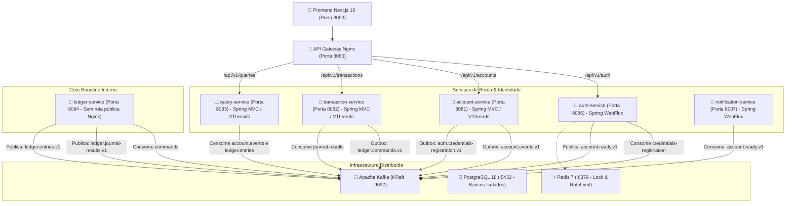

# Bank Ledger — Arquitetura Consolidada do Sistema

> **Documento Consolidado de Referência Técnica & Contexto para IA e Engenheiros**  
> *Versão:* 2.0 (Atualizado pós-otimizações reativas, autenticação assíncrona, Redis e microsserviço de notificações)  
> *Data de Consolidação:* Novembro de 2026

---

## 1. Visão Geral e Propósito do Projeto

O **Bank Ledger** é uma plataforma de **Core Bancário** (Ledger) desenhada para processamento financeiro corporativo de missão crítica (Nexus Bank). O sistema foi concebido para suportar altíssima concorrência com consistência matemática absoluta, eliminando por completo a possibilidade de inconsistência contábil, perda de dados ou saldos negativos em contas de clientes.

### Princípios Fundamentais de Domínio:
1. **Partidas Dobradas (Double-Entry Accounting):** Toda movimentação financeira é composta por pernas simétricas de débito e crédito que somam rigorosamente zero (`Total Débitos = Total Créditos`). Não existem saldos isolados ou transações unilaterais.
2. **Moeda e Precisão Monetária:** Apenas moeda BRL, com valores estritamente modelados como números inteiros em centavos (`Long`/`bigint`). **É proibido o uso de números de ponto flutuante (`float`/`double`)** para valores monetários.
3. **Consistência Eventual e Event-Driven Architecture:** Abertura de conta, provisionamento de credenciais e notificações operam de forma 100% assíncrona orientada a eventos via Apache Kafka, eliminando chamadas HTTP bloqueantes dentro de transações de banco.
4. **Idempotência Estrita de Dois Níveis:** Todas as operações mutáveis exigem o cabeçalho `Idempotency-Key` (UUIDv4), protegido por bloqueio em memória no Redis (Tier 1) e armazenamento definitivo no PostgreSQL (Tier 2).
5. **Autenticação Descentralizada:** Autenticação centralizada no `auth-service`, com emissão de JWTs assinados via RS256 e validação matemática local descentralizada nos demais microsserviços através de JWKS (RFC 7517) em memória.

---

## 2. Stack Tecnológica e Versões Oficiais

| Camada / Componente | Tecnologia | Versão | Função no Ecossistema |
| :--- | :--- | :--- | :--- |
| **Linguagem & Runtime** | Java OpenJDK (Virtual Threads ativas) | **25** | Execução de alta vazão no backend com I/O não bloqueante |
| **Framework Backend** | Spring Boot | **4.1.2** | Spring Framework 7, starters modulares, Jackson 3 |
| **Serialização JSON** | Jackson 3 (`tools.jackson`) | **3.1.7** | Deserialização estritamente tipada com envelopes CloudEvents (sem `JsonNode`) |
| **Build & Monorepo** | Gradle (Groovy DSL) | **9.x** | Gestão de dependências e automação de builds multi-serviço |
| **Banco de Dados** | PostgreSQL | **18 (Alpine)** | Bancos dedicados por serviço (*Database-per-Service*) |
| **Pool de Conexões** | HikariCP | Gerenciado | Sintonizado para alta concorrência: `max: 30`, `min: 10` |
| **Cache & In-Memory Lock**| Redis (com driver Lettuce Reativo) | **7 (Alpine)** | Rate limiting dinâmico (20 TPS) e lock de brute-force |
| **Mensageria** | Apache Kafka (KRaft mode) | **8.4.0** | Barramento de eventos assíncronos duráveis com 3 partições |
| **API Gateway** | Nginx | **1.27** | Ponto único de entrada na porta 8080 com CORS configurado |
| **Observabilidade** | OpenTelemetry + Grafana LGTM | All-in-One | Loki (Logs), Tempo (Traces), Mimir (Métricas), Grafana na porta 3001 |
| **Frontend Web** | Next.js (App Router / TypeScript) | **16.4.3** | Interface web de Web Banking (Tailwind CSS v4) na porta 3000 |

---

## 3. Topologia e Mapa dos Microsserviços

O ecossistema é composto por 6 microsserviços autônomos, 1 biblioteca comum compartilhada e 1 frontend web:



### Detalhamento por Microsserviço:

#### 1. `auth-service` (Porta 8086)
- **Tipo:** Reativo (Spring WebFlux + Netty).
- **Responsabilidades:**
  - Emissão de tokens JWT assimétricos (RS256, 2048-bit) com Key ID (`kid`) e endpoint público de chaves `GET /api/v1/auth/jwks.json` (RFC 7517).
  - Rotação de *Refresh Tokens* opacos e reutilização inteligente de tokens ativos com TTL dinâmico.
  - Criptografia de senhas rápida e resiliente via **BCrypt(10)** (com compatibilidade de leitura retroativa para `$argon2id$`).
  - **Lock de Contas no Redis:** Chaves `auth:failed_attempts:{cpf}` e `auth:lock:{cpf}` (TTL 15 min). A validação de bloqueio ocorre no Redis **antes** de tocar no banco de dados, protegendo o PostgreSQL e o CPU contra ataques de força bruta.
  - **Rate Limiting Dinâmico a 20 TPS:** `RateLimitingWebFilter` reativo no Redis. Endpoint `PUT /internal/auth/ratelimit` com payload `{"tps": 20}` para reconfiguração dinâmica em testes locais.
  - **Endpoint Reativo de Alto Tráfego:** `GET /internal/auth/users/{customerId}` e `by-cpf/{cpf}` protegido por `X-Internal-Service-Key`, retornando `AuthUserSummaryResponse` sanitizado (zero senhas, zero contadores).
  - Consumo assíncrono de `auth.credentials-registration.v1` e publicação de `AccountReadyEvent` no tópico `account.ready.v1`.

#### 2. `account-service` (Porta 8081)
- **Tipo:** Spring Boot MVC com Virtual Threads ativas.
- **Responsabilidades:**
  - Gestão de clientes (`Customer`), documentos (CPF com validação Módulo 11 estrita) e contas (`Account`).
  - **Abertura de Conta 100% Assíncrona:** O método `createAccount` persiste `Customer`, `Account` e dois registros de Outbox atômicos em **< 10ms**, devolvendo a conexão JDBC ao pool imediatamente. Zero chamadas síncronas HTTP bloqueando o banco.
  - Publica `AccountOpened` em `account.events.v1` e credenciais em `auth.credentials-registration.v1` via Outbox Poller.

#### 3. `transaction-service` (Porta 8082)
- **Tipo:** Spring Boot MVC com Virtual Threads ativas.
- **Responsabilidades:**
  - Ponto de entrada de depósitos, saques e transferências entre contas bancárias.
  - **Idempotência em Dois Níveis:**
    - *Tier 1 (Redis):* Lock atômico `SET lock:idempotency:{key} {worker} NX EX 60` para rejeição instantânea de requisições concorrentes idênticas (`409 Conflict`).
    - *Tier 2 (PostgreSQL):* Registro durável com hash SHA-256 do payload, status e resposta original para repetições legítimas (*replay*).
  - Responde imediatamente HTTP `202 Accepted` com cabeçalho `Location` para polling/acompanhamento.
  - Comunicação com o core contábil via tópico `ledger.commands.v1` e consumo da confirmação em `ledger.journal-results.v1`.

#### 4. `ledger-service` (Porta 8084 - Core Interno)
- **Tipo:** Spring Boot MVC com Virtual Threads ativas (sem exposição externa no Gateway).
- **Responsabilidades:**
  - Motor de Partidas Dobradas (Double-Entry Engine): gravação atômica e imutável de `Journal` e pernas de `Entry` (débitos e créditos).
  - **Alocação Híbrida de Shards de Caixa (`SYS-CASH`):** 16 shards de caixa (`SYS-CASH-00` a `SYS-CASH-15`) para distribuir o lock de concorrência em depósitos e saques (por terminal físico ou hash determinístico `hash(transactionId) % 16`).
  - **Lock Pessimista Anti-Deadlock:** `SELECT ... FOR UPDATE` ordenando os IDs de contas deterministicamente por UUID (`min(idA, idB)` antes de `max(idA, idB)`).
  - Segurança de microsserviço interno via validação do header `X-Internal-Service-Key`.

#### 5. `query-service` (Porta 8083)
- **Tipo:** Projeções de Leitura CQRS.
- **Responsabilidades:**
  - Projeções desnormalizadas de saldo (`account_balance`) e extrato oficial (`statement_entries`) persistidas no `query_db`.
  - Ingestão contínua de eventos via Kafka (`account.events.v1` e `ledger.entries.v1`).
  - **Mitigação Estrita de BOLA/IDOR:** Validação de que o usuário autenticado no JWT é o titular da conta consultada (ou perfil `ROLE_ADMIN`), retornando `403 Forbidden` com RFC 7807 ProblemDetail em caso de tentativa de acesso a conta alheia.

#### 6. `notification-service` (Porta 8087)
- **Tipo:** Full Reativo (Spring WebFlux + Netty).
- **Responsabilidades:**
  - Consumo assíncrono do tópico `account.ready.v1` através de listener Kafka fortemente tipado (sem `JsonNode`).
  - Envio de e-mails de boas-vindas via Google SMTP (`smtp.gmail.com:587`, TLS) isolando o I/O bloqueante do `JavaMailSender` no `Schedulers.boundedElastic()`.
  - **Feature Flag de Carga:** `app.mail.enabled: ${MAIL_ENABLED:true}`. Quando desativada, registra o log estruturado do envio sem disparar chamadas SMTP, permitindo testes de carga com 500+ threads com zero dependência externa.

#### 7. `platform-commons`
- **Biblioteca compartilhada interna (`services/platform-commons`)**:
  - `KafkaEventEnvelope<T>`: Envelope CloudEvents 1.0 reutilizável para serialização/deserialização Jackson 3 tipada.
  - `SecurityConstants` & `HttpHeaderConstants`: Centralização de cabeçalhos (`X-Internal-Service-Key`, `Idempotency-Key`, `Authorization`), constantes de retry reativo (3 tentativas, 50ms) e endpoints protegidos.
  - `InboxHandler`: Controle de idempotência de consumo no banco de dados local para garantir semântica *exactly-once*.
  - Records canônicos de domínio e DTOs de eventos (`AccountOpenedPayload`, `AccountReadyPayload`, `PostJournalCommandPayload`, `JournalPostedPayload`, `JournalRejectedPayload`, `EntryPostedPayload`, `RegisterCredentialsPayload`).

---

## 4. Padrões de Código e Diretrizes Arquiteturais (Regras de Ouro)

Qualquer IA, desenvolvedor ou agente autônomo que continuar o desenvolvimento deste projeto **DEVE** seguir rigorosamente estes padrões:

### 4.1 Arquitetura Hexagonal (Ports & Adapters)
- **Camada de Domínio (`domain`):** Pure Java POJOs/Records e exceções de domínio. **Zero dependências de frameworks** (proibido importar Spring, Hibernate, JPA ou Jackson em modelos e regras de negócio puras).
- **Camada de Aplicação (`application`):** Casos de uso (`*UseCase`), portas de entrada (`port.in`), portas de saída (`port.out`) e orquestração de serviços de aplicação.
- **Camada de Adaptadores (`adapters`):**
  - `adapters.in.rest`: Controllers REST, WebFilters e DTOs de entrada/saída.
  - `adapters.in.kafka`: Consumidores de mensageria com Acknowledgment manual.
  - `adapters.out.persistence`: Entidades JPA, Repositórios Spring Data e Mappers.
  - `adapters.out.kafka`: Produtores de eventos e adaptadores de publicação.
  - `adapters.out.redis`: Adaptadores de lock, cache e limitação de taxa.

### 4.2 Mensageria Kafka: Proibição Estrita de `JsonNode`
- **Regra:** Nunca utilizar `JsonNode`, `ObjectNode`, `readTree`, `treeToValue` ou `node.path(...)` em consumidores Kafka.
- **Padrão Obrigatório:** Utilizar sempre a desserialização tipada direta do Jackson 3 (`ObjectMapper.readValue`) com o envelope genérico:
  ```java
  KafkaEventEnvelope<MyPayload> envelope = objectMapper.readValue(
      record.value(),
      new TypeReference<KafkaEventEnvelope<MyPayload>>() {}
  );
  MyPayload payload = envelope.data() != null ? envelope.data() : objectMapper.readValue(record.value(), MyPayload.class);
  ```
- **Mapeamento Prévio:** Todos os atributos devem ser validados e convertidos para DTOs/Records fortemente tipados **antes** de acionar o `InboxHandler` ou o caso de uso de aplicação.

### 4.3 Banco de Dados e Conexões (HikariCP)
- **Tamanho dos Pools:** Todos os microsserviços utilizam o pool dimensionado para:
  ```yaml
  spring:
    datasource:
      hikari:
        maximum-pool-size: 30
        minimum-idle: 10
        connection-timeout: 30000
        leak-detection-threshold: 2000
  ```
- **Proibição de I/O Externo em Transações:** **É terminantemente proibido realizar chamadas HTTP de rede ou esperas longas dentro de métodos anotados com `@Transactional`**. Transações devem durar menos de 10ms. Comunicação entre serviços deve ser assíncrona via Outbox no Kafka.

### 4.4 Autenticação e Segurança
- **Assinatura e Validação:** Assinatura RS256 centralizada no `auth-service` e validação descentralizada nos Resource Servers via cache de chaves públicas do JWKS.
- **Tratamento de Erros:** Todos os erros de segurança (401 Unauthorized, 403 Forbidden, 429 Too Many Requests) retornam o padrão corporativo **RFC 7807 ProblemDetail**.
- **Serviços Internos:** Endpoints internos de infraestrutura (ex: chamadas ao `ledger-service` ou consultas de resumo no `auth-service`) utilizam autenticação por chave de serviço via header `X-Internal-Service-Key`.

---

## 5. Tópicos do Kafka e Contratos de Mensageria

| Tópico | Produtor | Consumidores | Payload / Evento | Função |
| :--- | :--- | :--- | :--- | :--- |
| `account.events.v1` | `account-service` | `ledger-service`, `query-service` | `AccountOpenedPayload` | Abertura de conta e provisionamento de conta contábil |
| `auth.credentials-registration.v1` | `account-service` | `auth-service` | `RegisterCredentialsPayload` | Registro assíncrono de credenciais com isolamento estrito |
| `account.ready.v1` | `auth-service` | `notification-service` | `AccountReadyPayload` | Sinalização de conta pronta para disparo de e-mail de boas-vindas |
| `ledger.commands.v1` | `transaction-service` | `ledger-service` | `PostJournalCommandPayload` | Solicitação de lançamento contábil em partidas dobradas |
| `ledger.journal-results.v1` | `ledger-service` | `transaction-service` | `JournalResultPayload` | Resultado da liquidação contábil (POSTED ou REJECTED) |
| `ledger.entries.v1` | `ledger-service` | `query-service` | `EntryPostedPayload` | Perna contábil individual para projeção desnormalizada de extrato |

---

## 6. Guia Prático de Execução e Desenvolvimento Local

### 6.1 Pré-requisitos
- **Java 25** instalado e configurado no `JAVA_HOME`.
- **Docker & Docker Compose** (versão 2.20+).
- **Node.js 20+** (para o frontend `web`).

### 6.2 Subindo a Infraestrutura com Docker Compose
```bash
# Subir toda a infraestrutura base (Postgres, Kafka KRaft, Redis 7, Nginx Gateway, Kafka UI e LGTM):
docker compose -f infra/docker/docker-compose.yml up -d postgres kafka kafka-init redis nginx kafka-ui
```

### 6.3 Executando os Testes do Backend (Gradle)
```bash
# Executar todos os testes de todos os 7 projetos (a partir da raiz):
cd services
./gradlew test

# Ou no Windows:
gradlew.bat test

# Testar um serviço específico:
gradlew.bat :auth-service:test
gradlew.bat :account-service:test
gradlew.bat :notification-service:test
```

### 6.4 Rodando os Microsserviços Localmente
```bash
# Exemplos de inicialização via Gradle:
gradlew.bat :auth-service:bootRun
gradlew.bat :account-service:bootRun
gradlew.bat :transaction-service:bootRun
gradlew.bat :ledger-service:bootRun
gradlew.bat :query-service:bootRun
gradlew.bat :notification-service:bootRun
```

### 6.5 Rodando o Frontend (Web Banking)
```bash
cd web
npm install
npm run dev
# Interface acessível em: http://localhost:3000
```

### 6.6 Derrubando a Infraestrutura e Limpando Recursos
```bash
docker compose -f infra/docker/docker-compose.yml down -v
```

---

## 7. Mapa de Portas e Endpoints Úteis

| Recurso / Serviço | URL / Host | Função |
| :--- | :--- | :--- |
| **Web Banking (Next.js)** | [`http://localhost:3000`](http://localhost:3000) | Interface gráfica de usuário do banco |
| **API Gateway (Nginx)** | `http://localhost:8080` | Ponto de entrada unificado com roteamento |
| **Auth Service** | `http://localhost:8086` | Login, JWKS (`/.well-known/jwks.json`), Rate Limit |
| **Account Service** | `http://localhost:8081` | Criação de clientes e contas |
| **Transaction Service** | `http://localhost:8082` | Depósitos, saques e transferências |
| **Query Service** | `http://localhost:8083` | Consultas de saldo e extrato bancário |
| **Ledger Service** | `http://localhost:8084` | Core bancário interno (privado) |
| **Notification Service** | `http://localhost:8087` | Notificações e e-mails reativos |
| **Kafka UI** | [`http://localhost:8085`](http://localhost:8085) | Inspeção visual de tópicos e partições Kafka |
| **Grafana UI (LGTM)** | [`http://localhost:3001`](http://localhost:3001) | Dashboards de Logs, Traces e Métricas (`admin`/`admin`) |
| **Redis 7** | `localhost:6379` | Cache, locks e rate-limiting reativo |
| **PostgreSQL 18** | `localhost:5432` | `auth_db`, `account_db`, `ledger_db`, `transaction_db`, `query_db` |
