# Documento de Separação de Responsabilidades: Backend vs. Frontend

**Projeto:** Nexus Bank Ledger  
**Branch:** `feature/business-rules-overhaul`  
**Data da Revisão:** 17 de Novembro de 2026 (Revisão de Segurança e Limites Dinâmicos)  
**Documento de Referência:** [`docs/superpowers/specs/2026-11-17-business-rules-and-profile-design.md`](file:///c:/Users/leosa/Documents/Projects/bank-ledger/docs/superpowers/specs/2026-11-17-business-rules-and-profile-design.md)

---

## 1. Visão Geral da Separação e Diretrizes de Segurança

Para garantir alta coesão, conformidade com a LGPD/OWASP e governança financeira avançada:
1. **Governança de Limites no Banco de Dados:** A validação de limites de transferência **não é estática no código**. Cada cliente/conta possui um limite individual aprovado e persistido no banco de dados (`daily_transfer_limit_cents`), permitindo aprovações diferenciadas (ex: R$ 5.000,00, R$ 50.000,00 ou R$ 250.000,00). O backend consulta o banco de dados a cada transação.
2. **Segurança de Dados Pessoais (LGPD/OWASP):** É estritamente **proibido trafegar CPF ou dados de conta via parâmetros de query em requisições `GET`** (pois query strings ficam registradas em logs de acesso de servidores web, proxies reversos, histórico de navegadores e cabeçalhos `Referer`). Todas as consultas de conta/favorecido utilizam **`POST /api/v1/accounts/lookup`** com corpo JSON cifrado via TLS.

```mermaid
graph LR
    subgraph BACKEND["BACKEND (Java 25 / Spring Boot / PostgreSQL / Kafka)"]
        direction TB
        B1["1. Limite Individual por Conta no Banco de Dados"]
        B2["2. Validação Dinâmica via Consulta SQL no Transaction-Service"]
        B3["3. POST /accounts/lookup Seguro (Payload JSON, Sem CPF em URL)"]
        B4["4. Geração de Protocolo Canônico Bancário (PRT-...)"]
        B5["5. Enriquecimento de Contraparte no Extrato (Query-Service)"]
        B6["6. Tabela e Edição de Endereço do Cliente (V3 Flyway)"]
    end

    subgraph FRONTEND["FRONTEND (Next.js 16 / React 19 / Tailwind v4)"]
        direction TB
        F1["1. Barra de Limite Reativa e Simulação ao Digitar"]
        F2["2. Toggle de Transferência: Agência/Conta vs. CPF"]
        F3["3. POST /accounts/lookup para Validação Segura"]
        F4["4. Card do Favorecido com Nome e CPF Reais Desmascarados"]
        F5["5. Extrato com Tipos e Descrições Amigáveis em PT-BR"]
        F6["6. Modal de Comprovante Bancário com Impressão Real"]
        F7["7. Modal de Comprovante Consolidado do Período"]
        F8["8. Exportação de Relatórios Reais em CSV e OFX"]
        F9["9. Modal/Tela de Perfil com Busca de CEP"]
    end

    BACKEND <-->|REST API + JSON Payload via POST| FRONTEND
```



---

## 2. Detalhamento das Responsabilidades: BACKEND

### 2.1. `account-service` (Porta 8081 / Rota Gateway `/api/v1/accounts`)

1. **Governança de Limite Aprovado por Conta no Banco de Dados:**
   - Migration `V3__add_customer_address_and_account_limits.sql`:
     - Coluna na tabela `account`:
       - `daily_transfer_limit_cents` (`BIGINT NOT NULL DEFAULT 5000000` = R$ 50.000,00 inicial, configurável por cliente).
     - Colunas na tabela `customer` para endereço:
       - `street` (`VARCHAR(150) NULL`)
       - `number` (`VARCHAR(20) NULL`)
       - `complement` (`VARCHAR(100) NULL`)
       - `neighborhood` (`VARCHAR(100) NULL`)
       - `city` (`VARCHAR(100) NULL`)
       - `state` (`VARCHAR(2) NULL`)
       - `postal_code` (`VARCHAR(8) NULL`)
2. **Consulta Segura de Conta/Destinatário via POST (`POST /api/v1/accounts/lookup`):**
   - **Endpoint:** `POST /api/v1/accounts/lookup`
   - **Corpo da Requisição (`AccountLookupRequest`):**
     ```json
     {
       "searchType": "CPF", // ou "ACCOUNT"
       "cpf": "52998224725", // opcional se searchType == "ACCOUNT"
       "agency": "0001",     // opcional se searchType == "CPF"
       "accountNumber": "100000" // opcional se searchType == "CPF"
     }
     ```
   - **Segurança:** Nenhum dado sensível (CPF/Conta) exposto em URLs ou logs de acesso.
   - **Resposta Desmascarada (`AccountLookupResponse`):**
     ```json
     {
       "accountId": "a3b4c5d6-...",
       "branch": "0001",
       "accountNumber": "100000",
       "checkDigit": "4",
       "holderName": "Carlos Eduardo Silva",
       "cpf": "529.982.247-25",
       "bankCode": "001",
       "bankName": "Nexus Bank S.A."
     }
     ```
3. **Endpoint de Edição de Perfil (`PUT /api/v1/accounts/me/profile`):**
   - Atualiza `phone`, `email` e endereço (`street`, `number`, `complement`, `neighborhood`, `city`, `state`, `postalCode`).
   - Bloqueia alteração de `cpf` e `fullName`.
4. **Consulta de Perfil Enriquecida (`GET /api/v1/accounts/me`):**
   - Retorna dados cadastrais completos incluindo endereço e limite diário aprovado para a conta.

### 2.2. `transaction-service` (Porta 8082 / Rota Gateway `/api/v1/transactions`)

1. **Remoção de Validação Estática no Código:**
   - Remoção da anotação `@Max(5_000_000L)` de `TransferRequest.java`. O código-fonte não deve impor limites arbitrários estáticos.
2. **Tabela e Consulta de Limites Individuais no Banco de Dados:**
   - Criação da tabela `account_limit` em `transaction-service` via migration Flyway:
     ```sql
     CREATE TABLE IF NOT EXISTS account_limit (
         account_id                 UUID PRIMARY KEY,
         daily_transfer_limit_cents BIGINT NOT NULL DEFAULT 5000000,
         approved_by                VARCHAR(80) NOT NULL DEFAULT 'SYSTEM_DEFAULT',
         updated_at                 TIMESTAMP WITH TIME ZONE NOT NULL DEFAULT now()
     );
     ```
   - No momento de efetuar uma transferência (`CreateTransferService`):
     1. Busca no banco de dados o limite diário aprovado para a conta de origem (`account_limit.daily_transfer_limit_cents`).
     2. Executa consulta agregada no banco de dados para somar as transferências do dia corrente daquela conta:
        ```sql
        SELECT COALESCE(SUM(amount), 0)
        FROM financial_transaction
        WHERE source_account_id = :sourceAccountId
          AND type = 'TRANSFER'
          AND status IN ('PENDING', 'COMPLETED')
          AND created_at >= :startOfDayBrt;
        ```
     3. Se `(usedTodayCents + request.amount) > approvedLimit`, rejeita com HTTP `422 Unprocessable Entity` (`ProblemDetail: DAILY_LIMIT_EXCEEDED`, detalhando o limite individual aprovado e o total consumido).
3. **Geração Canônica de Protocolo Bancário:**
   - Gera número de protocolo auditável `PRT-YYYYMMDD-XXXXXX`.
   - Persiste na coluna `protocol_number` da tabela `financial_transaction`.

### 2.3. `query-service` (Porta 8083 / Rota Gateway `/api/v1/queries`)

1. **Projeção do Limite Individual e Consumo Real:**
   - No endpoint `GET /api/v1/queries/accounts/{accountId}/balance`:
     - Retorna o `dailyLimitCents` específico cadastrado no banco para a conta.
     - Calcula dinamicamente `usedTodayCents` consultando os lançamentos de débito em `statement_entry` para o dia corrente.
     - Retorna `availableLimitCents = max(0, dailyLimitCents - usedTodayCents)`.
2. **Extrato Enriquecido:**
   - Retorna `protocolNumber`, dados completos da contraparte (`counterpartyName`, `counterpartyDocument`, `counterpartyAccount`) e categorias/tipos traduzidos.

---

## 3. Detalhamento das Responsabilidades: FRONTEND

### 3.1. Tela de Transferência (`/dashboard/transfer`)

1. **Consulta Segura de Favorecido via POST:**
   - Invoca `accountService.lookupAccount({ searchType, cpf, agency, accountNumber })` via requisição HTTP `POST`.
   - Nenhum dado sensível trafega na URL.
2. **Alternância entre Modos (Abas):**
   - **Por Agência e Conta:** Inputs de agência, conta e dígito.
   - **Por CPF:** Input com máscara automática `000.000.000-00`.
3. **Exibição do Favorecido Verificado sem Máscara:**
   - Card seguro exibindo Nome Completo Real, CPF Formatado, Agência/Conta e Instituição Bancária (001 - Nexus Bank).
4. **Painel de Limite Dinâmico e Reativo:**
   - Cards informativos com o limite aprovado no banco para o cliente (`dailyLimitCents`), consumido hoje (`usedTodayCents`) e disponível (`availableLimitCents`).
   - Barra de progresso visual recalculando em tempo real conforme o usuário digita o valor.
   - Bloqueio imediato do formulário caso o valor exceda o limite disponível do cliente.

### 3.2. Tela de Extrato Bancário (`/dashboard/statement`)

1. **Lançamentos Humanizados em Português:**
   - Badges e legendas: *Transferência enviada*, *Transferência recebida*, *Depósito em conta*, *Saque em terminal*.
2. **Identificação Precisa de Contraparte:**
   - Exibição de **"De: [Origem]"** em créditos e **"Para: [Favorecido]"** em débitos.
3. **Modal de Comprovante Bancário Oficial com Impressão Real:**
   - Exibe dados da operação, protocolo bancário `PRT-...` e hash de autenticação eletrônica.
   - Botão **"Imprimir Comprovante"** dispara impressão via folha de estilo `@media print` isolada em A4 limpo.
4. **Modal de Comprovante Consolidado Periódico:**
   - Exibe resumo patrimonial do período selecionado (Total Entradas, Total Saídas, Saldo Período) e botão de impressão contábil.
5. **Exportação de Relatórios Reais (CSV e OFX):**
   - Botão **"Exportar Relatório"** gera arquivos reais:
     - **CSV:** Formatado com `;` e codificação UTF-8 com BOM para Excel BR.
     - **OFX:** Arquivo padrão financeiro internacional para contabilidade.

### 3.3. Gestão de Perfil de Usuário e Endereço (`/dashboard/profile` ou Modal)

1. **Formulário de Perfil:**
   - Dados Pessoais imutáveis: Nome, CPF, Conta.
   - Dados de Contato editáveis: Telefone com máscara e E-mail.
   - Endereço Completo: CEP com máscara e autopreenchimento, Logradouro, Número, Complemento, Bairro, Cidade, Estado.
2. **Integração:** Envia `PUT /api/v1/accounts/me/profile` com feedback visual de sucesso via toast.

---

## 4. Matriz Atualizada de Contratos de API

| Microserviço | Método | Rota | Payload / Parâmetros | Justificativa / Segurança |
| :--- | :---: | :--- | :--- | :--- |
| `account-service` | `POST` | `/api/v1/accounts/lookup` | **Body JSON:** `{ searchType, cpf?, agency?, accountNumber? }` | **Segurança LGPD:** Elimina CPF de query string/logs; busca por conta ou CPF |
| `account-service` | `GET` | `/api/v1/accounts/me` | N/A (Token JWT no Header) | Retorna dados completos do perfil, endereço e limite aprovado |
| `account-service` | `PUT` | `/api/v1/accounts/me/profile` | **Body JSON:** `{ phone, email, address: { ... } }` | Atualização de dados de contato e endereço residencial |
| `transaction-service` | `POST` | `/api/v1/transactions/transfers` | **Body JSON:** `{ destinationAccountId, amount, description }` | Validação dinâmica no banco de dados contra o limite aprovado da conta |
| `query-service` | `GET` | `/api/v1/queries/accounts/{id}/balance` | Path: `accountId` | Retorna saldo e limite individual aprovado no banco + consumido hoje |
| `query-service` | `GET` | `/api/v1/queries/accounts/{id}/statement` | Query: `from`, `to`, `size` | Retorna lançamentos com protocolo bancário canônico e contraparte |
