# Documento de Separação de Responsabilidades: Backend vs. Frontend

**Projeto:** Nexus Bank Ledger  
**Branch:** `feature/business-rules-overhaul`  
**Data:** 17 de Novembro de 2026  
**Documento de Referência:** [`docs/superpowers/specs/2026-11-17-business-rules-and-profile-design.md`](file:///c:/Users/leosa/Documents/Projects/bank-ledger/docs/superpowers/specs/2026-11-17-business-rules-and-profile-design.md)

---

## 1. Visão Geral da Separação

Para garantir alta coesão, baixo acoplamento e independência de entrega, as 11 melhorias solicitadas foram estritamente categorizadas entre a camada de **Backend (Sistemas e Serviços)** e a camada de **Frontend (Interface e Experiência do Usuário)**.

```mermaid
graph LR
    subgraph BACKEND["BACKEND (Java 25 / Spring Boot / PostgreSQL / Kafka)"]
        direction TB
        B1["1. Regra e Validação do Limite Diário"]
        B2["2. Somatório do Limite Consumido no Dia"]
        B3["3. Lookup por CPF e Dados Desmascarados"]
        B4["4. Geração de Protocolo Canônico Bancário"]
        B5["5. Enriquecimento de Contraparte no Extrato"]
        B6["6. Tabela e Atualização de Endereço do Cliente"]
    end

    subgraph FRONTEND["FRONTEND (Next.js 16 / React 19 / Tailwind v4)"]
        direction TB
        F1["1. Barra de Limite Diário Reativa e Bloqueio Visual"]
        F2["2. Toggle de Transferência: Agência/Conta vs. CPF"]
        F3["3. Exibição do Favorecido Verificado sem Máscara"]
        F4["4. Extrato com Tipos e Descrições Amigáveis em PT-BR"]
        F5["5. Modal de Comprovante Bancário com Impressão Real"]
        F6["6. Modal de Comprovante Consolidado do Período"]
        F7["7. Exportação de Relatórios (CSV e OFX) com Dados Reais"]
        F8["8. Modal / Tela de Edição de Perfil com Busca de CEP"]
    end

    BACKEND <-->|REST API + JSON Contracts| FRONTEND
```

---

## 2. Detalhamento das Responsabilidades: BACKEND

O Backend é o guardião das regras de integridade contábil, segurança, persistência e auditoria.

### 2.1. `account-service` (Porta 8081 / Rota Gateway `/api/v1/accounts`)

1. **Migração de Banco de Dados (`V3__add_customer_address.sql`):**
   - Alteração na tabela `customer`:
     - `street` (`VARCHAR(150) NULL`) - Logradouro / Rua / Avenida
     - `number` (`VARCHAR(20) NULL`) - Número residencial
     - `complement` (`VARCHAR(100) NULL`) - Complemento (Apto, Bloco, etc.)
     - `neighborhood` (`VARCHAR(100) NULL`) - Bairro
     - `city` (`VARCHAR(100) NULL`) - Cidade / Município
     - `state` (`VARCHAR(2) NULL`) - UF (Estado)
     - `postal_code` (`VARCHAR(8) NULL`) - CEP (somente números)
2. **Endpoint de Edição de Perfil (`PUT /api/v1/accounts/me/profile`):**
   - Permite ao cliente logado atualizar seus dados de contato (`phone`, `email`) e endereço residencial (`street`, `number`, `complement`, `neighborhood`, `city`, `state`, `postalCode`).
   - Valida formato de e-mail e regras de consistência de endereço.
3. **Consulta de Perfil Enriquecida (`GET /api/v1/accounts/me`):**
   - Retorna os dados completos do titular, incluindo campos de endereço para pré-carregamento no formulário de edição do frontend.
4. **Lookup por Conta ou CPF (`GET /api/v1/accounts/lookup`):**
   - Suporte a dois modos de busca via query parameters:
     - `?agency=0001&number=100000`
     - `?cpf=52998224725` (ou com pontuação)
   - Resposta desmascarada para confirmação pré-transferência:
     - `accountId`: UUID da conta destino
     - `branch`: Agência
     - `accountNumber`: Número da conta
     - `checkDigit`: Dígito verificador
     - `holderName`: Nome completo real do titular (sem asteriscos)
     - `cpf`: CPF completo formatado do titular
     - `bankCode`: "001"
     - `bankName`: "Nexus Bank S.A."

### 2.2. `transaction-service` (Porta 8082 / Rota Gateway `/api/v1/transactions`)

1. **Geração Canônica de Protocolo Bancário:**
   - Criação de número de protocolo auditável em formato bancário padrão:  
     `PRT-YYYYMMDD-<6-HEX-CHARS>` (Exemplo: `PRT-20261117-4B8F12`).
   - Armazenamento na coluna `protocol_number` da tabela `financial_transaction`.
   - Propagação no evento de comando contábil para o motor de partidas dobradas e serviço de query.
2. **Validação de Limite Diário de Transferências:**
   - Ao receber `POST /transactions/transfers`:
     - Verifica se o valor solicitado mais o total já transferido no dia não ultrapassa o limite diário configurado para a conta.
     - Caso ultrapasse, retorna HTTP `422 Unprocessable Entity` com `ProblemDetail`:  
       `"Limite diário de transferências excedido. Disponível: R$ X,XX, Solicitado: R$ Y,YY"`.

### 2.3. `query-service` (Porta 8083 / Rota Gateway `/api/v1/queries`)

1. **Computação do Limite Consumido no Dia (`usedTodayCents`):**
   - No endpoint `GET /accounts/{accountId}/balance`:
     - Calcula dinamicamente a soma de lançamentos de débito de transferência ocorridos no dia civil corrente (UTC-3).
     - Retorna no `BalanceResponse`:
       - `dailyLimitCents`: Limite total (Ex: 5.000.000 centavos = R$ 50.000,00).
       - `usedTodayCents`: Total consumido hoje (Ex: 150.000 centavos = R$ 1.500,00).
       - `availableLimitCents`: Limite restante disponível (`dailyLimitCents - usedTodayCents`).
2. **Enriquecimento do Extrato (`GET /accounts/{accountId}/statement`):**
   - Retorna cada lançamento com dados auditáveis completos:
     - `protocolNumber`: Protocolo canônico bancário gerado.
     - `counterpartyName`: Nome completo da contraparte (pagador ou favorecido).
     - `counterpartyDocument`: Documento / CPF formatado da contraparte.
     - `counterpartyAccount`: Agência e Conta da contraparte.
     - `category` e `type`: Categorias canônicas padronizadas.

---

## 3. Detalhamento das Responsabilidades: FRONTEND

O Frontend é responsável pela experiência do usuário, interatividade fluida, validação visual em tempo real e acessibilidade (WCAG AAA).

### 3.1. Tela de Transferência (`/dashboard/transfer`)

1. **Alternância de Modalidade (Tabs):**
   - Opção 1: **Transferência por Agência e Conta** (Campos: Agência, Conta com Dígito).
   - Opção 2: **Transferência por CPF** (Campo com máscara automática `000.000.000-00`).
2. **Verificação do Destinatário com Dados Desmascarados:**
   - Ao preencher os campos ou clicar no botão "Verificar Conta", o frontend executa o lookup e exibe o **Cartão do Favorecido**:
     - Nome Completo (sem asteriscos)
     - CPF formatado completo
     - Banco (001 - Nexus Bank S.A.)
     - Agência e Conta com Dígito
3. **Painel de Limite Diário Reativo:**
   - Exibição de cards informativos:
     - Limite Diário Total: `R$ 50.000,00`
     - Limite Usado Hoje: `R$ X,XX`
     - Limite Disponível: `R$ Y,YY`
   - **Simulação em Tempo Real:** À medida que o usuário digita o valor a ser transferido, a barra de progresso visual atualiza instantaneamente calculando o consumo projetado.
   - **Validação Antecipada:** Se o valor digitado exceder o limite disponível, a barra fica vermelha e o botão de envio é desabilitado com mensagem de erro clara.

### 3.2. Tela de Extrato Bancário (`/dashboard/statement`)

1. **Humanização dos Lançamentos em Português:**
   - Ícones e badges semânticos para cada tipo:
     - `TRANSFER_OUT` -> **Transferência enviada** (badge vermelho/laranja, valor `- R$ X,XX`)
     - `TRANSFER_IN` -> **Transferência recebida** (badge verde, valor `+ R$ X,XX`)
     - `DEPOSIT` -> **Depósito em conta** (badge verde, valor `+ R$ X,XX`)
     - `WITHDRAWAL` -> **Saque em terminal** (badge cinza/âmbar, valor `- R$ X,XX`)
2. **Exibição Correta de Origem e Destino:**
   - Cada linha do extrato identifica com precisão:
     - Se foi débito: **Para:** Nome do favorecido, Agência e Conta.
     - Se foi crédito: **De:** Nome da origem/pagador, Agência e Conta.
3. **Modal de Comprovante Bancário Oficial:**
   - Ao clicar no botão "Comprovante" de uma transação:
     - Abre modal estilizado como Comprovante Bancário Oficial.
     - Exibe: Logotipo do banco, Protocolo bancário canônico (`PRT-...`), Data/Hora exatas, Dados do Pagador (Origem), Dados do Favorecido (Destino), Valor em BRL e Autenticação Eletrônica (Hash SHA-256).
   - **Botão "Imprimir Comprovante":**
     - Executa `window.print()` estilizado com classe `@media print` que isola exclusivamente a área do comprovante em folha A4 limpa, sem imprimir menus, cabeçalhos ou fundos escuros da interface.
4. **Botão "Comprovante Consolidado":**
   - Substitui o placeholder existente (`alert`) por um **Modal de Extrato Consolidado Periódico**:
     - Filtro por período (Mês atual, últimos 30 dias, 60 dias).
     - Sumário contábil: Total de Entradas (+), Total de Saídas (-), Saldo Inicial e Saldo Final.
     - Lista sintética das operações.
     - Botão de impressão do consolidado para prestação de contas contábil.
5. **Botão "Exportar Relatório":**
   - Substitui os placeholders de mock por exportadores reais executados com os dados filtrados:
     - **CSV:** Download de arquivo `.csv` codificado em UTF-8 com BOM e delimitador `;`, formatado para Excel com colunas: *Data, Protocolo, Tipo, Descrição, Contraparte, Documento, Agência, Conta, Natureza, Valor, Saldo*.
     - **OFX:** Download de arquivo `.ofx` padrão bancário XML/SGML compatível com sistemas contábeis como ContaAzul e QuickBooks.

### 3.3. Gestão de Perfil do Usuário e Endereço (`/dashboard/profile` ou Modal no Header)

1. **Interface de Perfil:**
   - Acesso via avatar / ícone de usuário no cabeçalho ou menu lateral.
   - **Seção de Dados Pessoais (Somente Leitura):** Nome Completo, CPF, Data de Nascimento, Agência e Conta.
   - **Seção de Contato (Editável):** Telefone celular (com máscara `(00) 00000-0000`) e E-mail.
   - **Seção de Endereço Residencial (Editável):**
     - Campo CEP (com máscara `00000-000`) e busca automática de endereço.
     - Logradouro / Rua, Número, Complemento, Bairro, Cidade e UF.
2. **Integração e Feedback:**
   - Salva via `PUT /api/v1/accounts/me/profile`.
   - Notificação visual de sucesso (toast verde) e tratamento de erros.

---

## 4. Tabela Resumo: Matriz de Entregáveis

| Funcionalidade Solicitada | Camada Backend | Camada Frontend |
| :--- | :--- | :--- |
| **1. Limite Diário de Transferência** | Cálculo de `usedTodayCents` no `query-service`; Validação de teto no `transaction-service`. | Exibição de cards de limite; Barra de consumo reativa; Bloqueio no formulário se exceder. |
| **2. Extrato Detalhado & Português** | Padronização dos tipos contábeis e naturezas (`CREDIT`/`DEBIT`). | Mapeamento semântico dos títulos, subtítulos, badges e cores em PT-BR. |
| **3. Contraparte e Origem** | Persistência de nome, documento e conta da contraparte em `statement_entry`. | Renderização explícita de "De: [Origem]" e "Para: [Favorecido]". |
| **4. Dados Corretos no Comprovante** | Projeção fidedigna de dados do lançamento contábil. | Modal estruturado no padrão bancário oficial brasileiro. |
| **5. Protocolo Bancário** | Geração e armazenamento do protocolo canônico (`PRT-YYYYMMDD-XXXXXX`). | Exibição destacada do protocolo no comprovante e no extrato. |
| **6. Botão Imprimir** | N/A (Consumo de dados já persistidos). | Implementação de folha de estilo `@media print` para impressão A4 do comprovante. |
| **7. Botão Comprovante Consolidado** | Endpoint de extrato com filtros por data (`from`/`to`). | Modal de demonstrativo financeiro consolidado com sumário e impressão. |
| **8. Botão Exportar Relatório** | N/A (Utiliza os dados estruturados do extrato). | Gerador cliente de arquivos `.csv` (Excel PT-BR) e `.ofx` (padrão financeiro). |
| **9. Edição de Perfil e Endereço** | Migration `V3` (colunas de endereço) + Endpoint `PUT /accounts/me/profile`. | Interface de visualização e edição de perfil com busca de CEP e máscaras. |
| **10. Destinatário sem Mascaramento** | Endpoint `/accounts/lookup` retornando nome e CPF sem asteriscos. | Card de confirmação pré-transferência exibindo nome e CPF reais. |
| **11. Transferência por CPF** | `account-service` aceita busca por CPF via query param `?cpf=...`. | Tabs de seleção (Conta vs. CPF), input com máscara de CPF e lookup dinâmico. |
