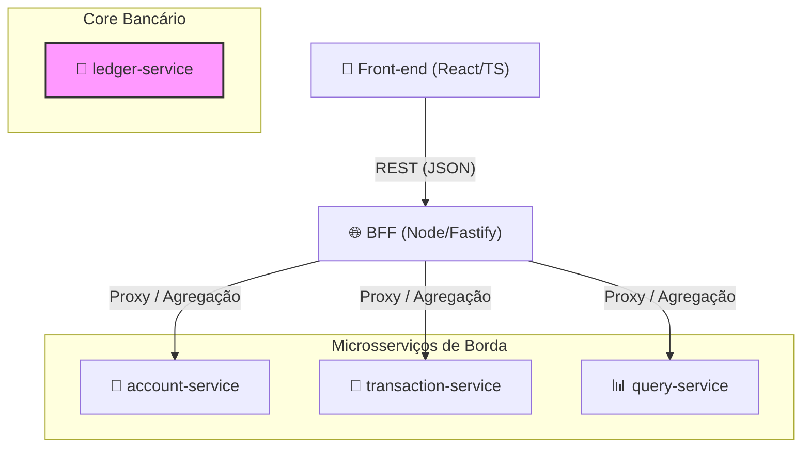
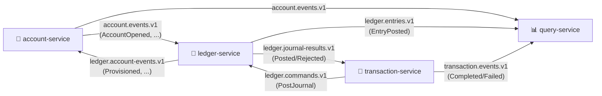
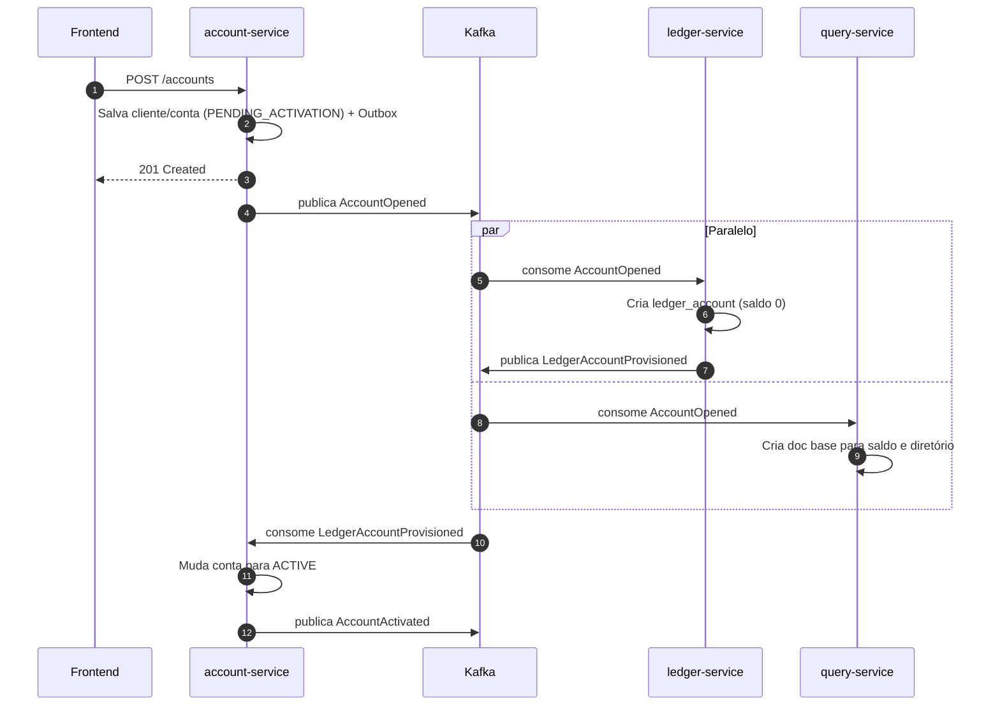
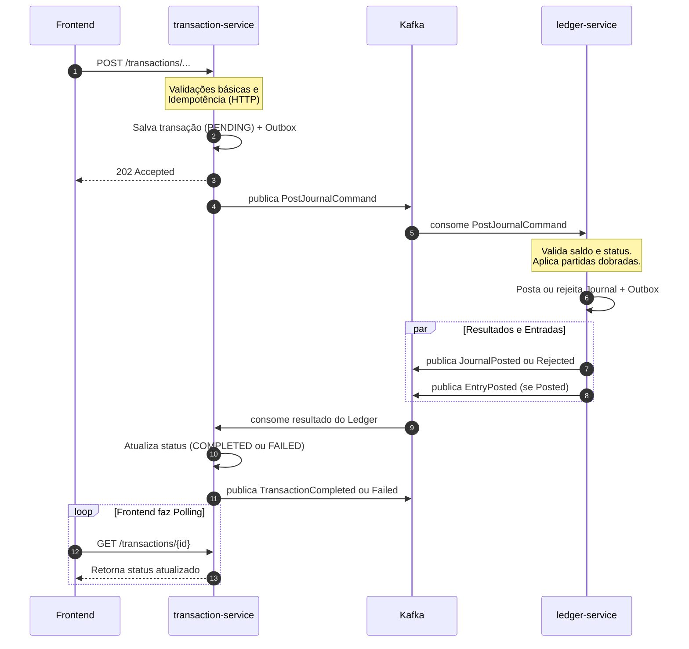

# Plano de Desenvolvimento — Ledger Bancário (laboratório)

Plano para execução solo, em passos sequenciais (sem sprints). Nenhum código é desenvolvido aqui: apenas decisões, contratos e roteiro. Versões citadas (Java 25, Spring Boot 4.1.1) devem ser confirmadas no start.spring.io e nas release notes antes de começar, pois a linha 4.x trouxe starters modulares, Jackson 3 e Spring Framework 7.

## 1. Objetivo, escopo e premissas

**Objetivo:** praticar conceitos bancários (conta, partidas dobradas, saldo, extrato, limites, idempotência, consistência eventual) junto com mensageria Kafka, CQRS e operação em Docker e Kubernetes.

**Escopo:** abertura de conta, login, depósito, saque, transferência entre contas, consulta de saldo e extrato.

**Fora de escopo:** Pix/boleto/cartão, estorno/reversão, tarifas, juros, KYC real, multi-moeda, cheque especial.

**Premissas:** moeda única BRL; valores inteiros em centavos (`long`), nunca `double`; sem saldo negativo; um titular por conta; uma conta por CPF; dados fictícios; sem infraestrutura externa (tudo roda local).

## 2. Decisões de arquitetura (resumo)

| Tema | Decisão | Motivo |
| --- | --- | --- |
| Serviços | account, transaction, ledger, query + BFF Node | Separa cadastro, intenção de transação, fonte da verdade do saldo e leitura |
| Banco de escrita | PostgreSQL, um database por serviço (uma instância local, três databases e usuários distintos). **Tabelas de alto volume particionadas por Mês/Ano.** | ACID, locks de linha, constraints. Particionamento facilita retenção, expurgo e performance temporal. |
| Read model | MongoDB (experimento) com Postgres como alternativa | Documento denormalizado de extrato; ver seção 4 |
| Kafka | 1 broker em modo KRaft, tópicos com 3 partições, **JSON com envelope versionado** | Simplicidade local: sem Schema Registry, sem Kafka Connect e sem Debezium. Comunicação direta via Spring Kafka. |
| Confiabilidade | Outbox na aplicação (poller `platform-commons`) + Inbox no consumidor | Evita dual write e dispensa CDC/plugins externos; entrega at-least-once com efeito exatamente uma vez no banco. |
| Ledger | Partidas dobradas, entradas imutáveis, saldo materializado | Padrão de mercado para auditabilidade |
| Transferência | Um único lançamento (journal) atômico no ledger | O ledger é dono de todos os saldos, logo não precisa de saga distribuída |
| Autenticação | JWT emitido pelo account-service; demais serviços como resource server | Mantém simples e realista |
| Estilo da API | REST síncrono na borda, 202 Accepted para transações, processamento assíncrono interno | Mostra consistência eventual de forma explícita |
| Arquitetura interna | Arquitetura Hexagonal (Ports & Adapters) mandatória nos serviços backend | Isola regras de domínio financeiro de frameworks (Spring), persistência e mensageria; viabiliza testes puros e evolução independente |

## 3. Arquitetura e fluxos

### 3.1. Visão Geral dos Componentes e APIs (Síncrono)


*(O `ledger-service` não expõe API pública, comunicando-se apenas assincronamente ou via endpoints internos).*

### 3.2. Topologia de Mensageria (Assíncrono via Kafka)



### 3.3. Responsabilidades por Serviço

- **`account-service`:** Gerencia cliente, conta, credenciais, login e o ciclo de vida da conta (status).
- **`transaction-service`:** Recebe intenções de depósito, saque e transferência. Valida a requisição, aplica idempotência HTTP, cria a transação com status `PENDING` e emite o comando ao ledger. Finaliza a transação ao receber o resultado.
- **`ledger-service`:** Fonte da verdade e dono dos saldos. Posta lançamentos usando o princípio de partidas dobradas, valida saldo e status da conta. Emite os resultados e novas entradas no diário.
- **`query-service`:** Mantém as projeções de saldo e extrato, materializando o lado de leitura do CQRS.
- **`BFF (Backend for Frontend)`:** Guarda o token JWT em cookie `httpOnly` para segurança, faz proxy roteando as chamadas para o backend e agrega dados para o front.

### 3.4. Fluxos de Negócio

#### Abertura de Conta
A criação de conta envolve comunicação assíncrona entre serviços para garantir isolamento e consistência eventual.



#### Transações Financeiras (Depósito, Saque, Transferência)
Toda transação segue um padrão onde a intenção é registrada e processada assincronamente pelo core bancário.



- **Depósito:** O `PostJournalCommand` solicita débito na conta de sistema (`CASH`) e crédito na conta do cliente.
- **Saque:** Semelhante, mas valida saldo da conta do cliente antes do débito e credita a conta `CASH`.
- **Transferência:** Um único journal atômico (transação de banco de dados no ledger) executa o débito na origem e o crédito no destino. Valida o status de ambas as contas e o saldo da conta origem.

## 4. PostgreSQL vs MongoDB

| Critério | PostgreSQL | MongoDB |
| --- | --- | --- |
| Transações ACID | Nativas, maduras, isolamento configurável | Multi-documento exige replica set (single node local) e tem custo de desempenho |
| Integridade | CHECK, FK, UNIQUE, triggers | Validação por schema, sem FK; unicidade só por índice |
| Controle de concorrência no saldo | `SELECT ... FOR UPDATE`, lock otimista com `version` | Operações atômicas por documento (`$inc` condicional), mais difícil em dois documentos |
| Consultas de auditoria e reconciliação | SQL, joins e agregações simples | Aggregation pipeline, mais verboso |
| Modelo de extrato | Precisa de índice e paginação por cursor | Documento já denormalizado, leitura muito rápida |
| Evolução de schema | Flyway, migrações explícitas | Flexível, com risco de dados inconsistentes |
| Operação local | Um container leve | Um container (mais replica set se usar transações) |

**Recomendação:** Postgres em todos os serviços de escrita (account, transaction, ledger), pois dinheiro exige integridade e controle de concorrência. Adicionalmente, as tabelas de dados históricos no PostgreSQL serão particionadas por RANGE temporal. MongoDB apenas no query-service, onde o modelo é um documento denormalizado reconstruível a partir dos eventos. 

## 5. CQRS

**Aplicação aqui:** o lado de comando (account, transaction, ledger) grava o estado em Postgres; o lado de consulta (query-service) mantém projeções alimentadas por eventos Kafka. Não será usado event sourcing completo: o ledger é state-stored, mas suas entradas são imutáveis e sequenciadas, o que já funciona como um log de eventos de domínio.

**Projeção e ordenação:** `ledger.entries.v1` usa `accountId` como chave, garantindo ordem por conta dentro da partição. Cada entrada traz `sequence` (contador por conta). A projeção aplica somente se `sequence == lastSequence + 1`; se for menor, ignora (duplicata); se for maior, aguarda via retry (lacuna).

**Consistência eventual:** o saldo do query-service pode atrasar frente ao ledger. Mitigações: a resposta do saldo inclui `asOfSequence` e `updatedAt`; o status da transação vem do transaction-service (fonte de verdade da intenção); validações de saque são feitas sempre no ledger, nunca no read model.

**Reconstrução:** a projeção deve poder ser recriada resetando o offset do consumer group e limpando as coleções (exercício obrigatório do plano).

## 6. Idempotência

Camadas combinadas:

1. **API (HTTP):** header obrigatório `Idempotency-Key` (UUID) nos POSTs de transação. Tabela `idempotency_key` com escopo (accountId do JWT), chave, `request_hash` (SHA-256 do corpo normalizado), status (IN_PROGRESS ou COMPLETED), resposta guardada e expiração (24 h). Mesma chave e mesmo hash devolvem a resposta original; mesma chave com corpo diferente devolve 422 `IDEMPOTENCY_KEY_REUSED`; chave em andamento devolve 409 `IDEMPOTENCY_IN_PROGRESS`.
2. **Domínio (ledger):** `journal.transaction_id` com UNIQUE. Reprocessar o mesmo comando devolve o resultado já registrado, sem lançar de novo (inclusive para rejeições, que também são gravadas).
3. **Consumidor (inbox):** tabela `inbox_event(event_id, handler, processed_at PK)`; o handler insere os dados e processa na mesma transação; conflito significa duplicata e o commit é feito sem reprocessar.
4. **Produtor:** `enable.idempotence=true`, `acks=all`, e padrão Outbox (poller com `FOR UPDATE SKIP LOCKED`, lotes de 100, intervalo de 200 ms).
5. **Kafka transactions/EOS:** avaliado e não adotado na v1: não cobrem efeito colateral no banco; at-least-once com consumidor idempotente é mais simples e robusto.

Consumidores com `enable.auto.commit=false` e commit do offset somente após o commit do banco.

## 7. Domínio e regras de negócio

### 7.1 Partidas dobradas e Fluxo de Fundos

O princípio de partidas dobradas garante que o dinheiro não seja "criado" nem "destruído" no sistema, apenas movido. Toda transação exige que a soma dos valores debitados seja igual à soma dos valores creditados. O `ledger-service` garante isso gravando sempre 1 `journal` e no mínimo 2 `entries` (uma de débito, outra de crédito) atomicamente no banco de dados.

**Natureza das Contas (`ledger_account.kind`):**
- **Contas de Cliente (Passivo):** O dinheiro depositado pelo cliente é uma dívida do banco com ele. Por ter natureza credora, **Créditos aumentam o saldo** e **Débitos diminuem o saldo**.
- **Contas de Sistema / Caixa (Ativo):** Representam o "cofre" do banco ou a liquidação externa. Por ter natureza devedora, funcionam ao contrário: Débitos aumentam o ativo do banco.

Para o sistema, o fluxo do dinheiro se comporta da seguinte forma:

| Operação | Onde ocorre o Débito | Onde ocorre o Crédito | Efeito Prático |
| --- | --- | --- | --- |
| **Depósito** | Conta de Sistema (`SYS-CASH-nn`) | Conta do Cliente | O cofre do banco recebe dinheiro externo (+); o saldo do cliente aumenta (+). |
| **Saque** | Conta do Cliente | Conta de Sistema (`SYS-CASH-nn`) | O saldo do cliente diminui (-); o cofre do banco entrega o dinheiro (-). |
| **Transferência**| Conta Origem (Cliente A) | Conta Destino (Cliente B) | O banco transfere a dívida de um cliente para outro, o cofre não é envolvido. |

**Atenção a "Hot Row" (Contenção de Lock no PostgreSQL):**
Todas as entradas e saídas do banco (depósitos e saques) batem na conta do "cofre" (CASH). Se existisse apenas uma conta `CASH`, o Postgres criaria uma fila (lock), bloqueando as operações simultâneas de todos os usuários e derrubando a vazão do sistema.
Para evitar isso, inicializamos **16 contas de caixa (`SYS-CASH-00` a `SYS-CASH-15`)** (também chamadas de shards). O produtor do comando escolhe aleatoriamente (por hash do `transactionId`) qual desses "cofres" vai receber/entregar o dinheiro, diluindo a concorrência na tabela `ledger_account`.

### 7.2 Regras por operação

**Abertura de conta**
- CPF válido (dígitos verificadores, rejeitar sequências repetidas), único.
- Idade mínima 18 anos pela data de nascimento; nome com pelo menos 2 palavras; e-mail e telefone (E.164) em formato válido.
- Senha com mínimo de 8 caracteres, armazenada com Argon2 ou BCrypt.
- Agência fixa `0001`; número gerado por sequence mais dígito verificador (módulo 11).
- Conta nasce PENDING_ACTIVATION e só opera após ACTIVE.

**Depósito:** valor entre 0,01 e o limite por operação (configurável, ex.: R$ 50.000); conta ACTIVE; apenas na própria conta do usuário autenticado.

**Saque:** conta ACTIVE; saldo suficiente (sem cheque especial); limite por operação e limite diário de saques (opcional, soma de débitos do dia no ledger).

**Transferência:** contas distintas (`SAME_ACCOUNT_TRANSFER`); origem pertence ao usuário autenticado; origem e destino ACTIVE; saldo suficiente; mesma moeda; limite por operação e diário.

**Ciclo de vida da conta:** PENDING_ACTIVATION → ACTIVE ⇄ BLOCKED → CLOSED. BLOCKED não debita nem credita. Encerramento exige saldo zero.

**Estados da transação:** PENDING → COMPLETED ou FAILED. Transições são validadas (estado final é imutável). Um reconciliador marca como FAILED (`TIMEOUT`) transações PENDING há mais de N minutos, depois de consultar o ledger pelo `transactionId`.

### 7.3 Catálogo de erros (RFC 9457 Problem Details)

| Código | HTTP | Quando |
| --- | --- | --- |
| INVALID_CPF / UNDERAGE / DUPLICATE_CPF | 422 / 422 / 409 | Abertura de conta |
| INVALID_AMOUNT | 400 | Valor ≤ 0 ou acima do limite |
| ACCOUNT_NOT_FOUND | 404 | Conta inexistente |
| ACCOUNT_NOT_ACTIVE | 422 | Conta pendente, bloqueada ou encerrada |
| INSUFFICIENT_FUNDS | 422 (no resultado da transação) | Saldo menor que o débito |
| SAME_ACCOUNT_TRANSFER | 422 | Origem igual ao destino |
| LIMIT_EXCEEDED | 422 | Limite por operação ou diário |
| FORBIDDEN_ACCOUNT_ACCESS | 403 | Conta de origem não pertence ao token |
| IDEMPOTENCY_KEY_REUSED / IDEMPOTENCY_IN_PROGRESS | 422 / 409 | Seção 6 |
| MISSING_IDEMPOTENCY_KEY | 400 | Header ausente |

Erros de negócio detectados só no ledger (saldo, status) aparecem como `status=FAILED` com `failureCode` na transação, pois o fluxo é assíncrono.

## 8. Modelos de dados

Todos os ids são UUID (v7 se possível, para ordenação); datas em `timestamptz` UTC; migrações com Flyway. As tabelas de eventos e transações utilizam particionamento nativo `PARTITION BY RANGE` por Mês/Ano.

### 8.1 Modelo físico: convenções

- Ids `uuid` gerados pela aplicação (v7). Datas `timestamptz` em UTC. Valores monetários em `bigint` (centavos) com `currency char(3)`.
- Enums como `varchar` + `CHECK` (evolui mais fácil que `CREATE TYPE`). Nomes em snake_case e constraints nomeadas com prefixos `pk_`, `uk_`, `fk_`, `ck_`, `ix_`.
- `version bigint` nas tabelas mutáveis, mapeado com `@Version` (lock otimista).
- Chaves Estrangeiras (FKs) limitadas em tabelas particionadas para simplificação (validadas por software e eventos).
- CPF em `char(11)` com UNIQUE; nunca aparece em log sem máscara. 
- Databases `account_db`, `transaction_db` e `ledger_db`, criados em `infra/docker/postgres/init.sql`.

### 8.2 Outbox e inbox (Particionados; iguais em account, transaction e ledger)

A chave de particionamento (`created_at` / `processed_at`) precisa fazer parte da Primary Key.

```sql
CREATE TABLE outbox_event (
  id             uuid         NOT NULL,              -- = eventId do envelope
  aggregate_type varchar(40)  NOT NULL,
  aggregate_id   uuid         NOT NULL,
  event_type     varchar(80)  NOT NULL,
  event_version  int          NOT NULL DEFAULT 1,
  topic          varchar(120) NOT NULL,
  message_key    varchar(64)  NOT NULL,
  payload        jsonb        NOT NULL,
  headers        jsonb        NOT NULL DEFAULT '{}'::jsonb,
  created_at     timestamptz  NOT NULL DEFAULT now(),
  published_at   timestamptz,
  attempts       int          NOT NULL DEFAULT 0,
  CONSTRAINT pk_outbox_event PRIMARY KEY (id, created_at)
) PARTITION BY RANGE (created_at);

CREATE TABLE outbox_event_y2026m10 PARTITION OF outbox_event FOR VALUES FROM ('2026-10-01 00:00:00Z') TO ('2026-11-01 00:00:00Z');
CREATE INDEX ix_outbox_pending ON outbox_event (created_at) WHERE published_at IS NULL;

CREATE TABLE inbox_event (
  event_id     uuid         NOT NULL,
  handler      varchar(80)  NOT NULL,                -- ex.: LedgerAccountProvisionedHandler
  processed_at timestamptz  NOT NULL DEFAULT now(),
  CONSTRAINT pk_inbox_event PRIMARY KEY (event_id, handler, processed_at)
) PARTITION BY RANGE (processed_at);

CREATE TABLE inbox_event_y2026m10 PARTITION OF inbox_event FOR VALUES FROM ('2026-10-01 00:00:00Z') TO ('2026-11-01 00:00:00Z');
```

O poller lê `WHERE published_at IS NULL ORDER BY created_at LIMIT 100 FOR UPDATE SKIP LOCKED`. A rotina de limpeza é feita executando `DROP TABLE` na partição inteira do mês passado (para outbox/inbox).

### 8.3 account-service

Sem particionamento, pois estas tabelas não recebem uma carga contínua infinita como as transacionais.

```sql
CREATE SEQUENCE account_number_seq START 100000;   -- o dígito (módulo 11) é calculado pela aplicação

CREATE TABLE customer (
  id                    uuid         PRIMARY KEY,
  full_name             varchar(120) NOT NULL,
  cpf                   char(11)     NOT NULL,
  birth_date            date         NOT NULL,
  email                 varchar(254) NOT NULL,
  phone                 varchar(16)  NOT NULL,
  password_hash         varchar(100) NOT NULL,
  failed_login_attempts int          NOT NULL DEFAULT 0,
  locked_until          timestamptz,
  created_at            timestamptz  NOT NULL DEFAULT now(),
  updated_at            timestamptz  NOT NULL DEFAULT now(),
  version               bigint       NOT NULL DEFAULT 0,
  CONSTRAINT uk_customer_cpf   UNIQUE (cpf),
  CONSTRAINT uk_customer_email UNIQUE (email),
  CONSTRAINT ck_customer_cpf   CHECK (cpf ~ '^[0-9]{11}$'),
  CONSTRAINT ck_customer_phone CHECK (phone ~ '^[+][0-9]{10,15}$')
);

CREATE TABLE account (
  id            uuid        PRIMARY KEY,
  customer_id   uuid        NOT NULL,
  agency        char(4)     NOT NULL DEFAULT '0001',
  number        varchar(10) NOT NULL,
  digit         char(1)     NOT NULL,
  type          varchar(20) NOT NULL DEFAULT 'CHECKING',
  status        varchar(24) NOT NULL,
  status_reason varchar(140),
  opened_at     timestamptz NOT NULL DEFAULT now(),
  activated_at  timestamptz,
  closed_at     timestamptz,
  version       bigint      NOT NULL DEFAULT 0,
  CONSTRAINT fk_account_customer      FOREIGN KEY (customer_id) REFERENCES customer (id),
  CONSTRAINT uk_account_agency_number UNIQUE (agency, number),
  CONSTRAINT uk_account_customer      UNIQUE (customer_id),     -- uma conta por CPF na v1
  CONSTRAINT ck_account_type          CHECK (type IN ('CHECKING')),
  CONSTRAINT ck_account_status        CHECK (status IN ('PENDING_ACTIVATION','ACTIVE','BLOCKED','CLOSED'))
);
CREATE INDEX ix_account_status ON account (status);

CREATE TABLE account_status_history (
  id          bigserial   PRIMARY KEY,
  account_id  uuid        NOT NULL REFERENCES account (id),
  from_status varchar(24),
  to_status   varchar(24) NOT NULL,
  reason      varchar(140),
  changed_by  uuid,                                  -- customerId ou admin; nulo quando automático
  changed_at  timestamptz NOT NULL DEFAULT now()
);
CREATE INDEX ix_account_status_history_account ON account_status_history (account_id, changed_at DESC);
```

### 8.4 transaction-service

A tabela `financial_transaction` é particionada por data de criação (`created_at`).

```sql
CREATE TABLE financial_transaction (
  id                     uuid         NOT NULL,
  type                   varchar(16)  NOT NULL,
  status                 varchar(16)  NOT NULL,
  source_account_id      uuid,
  destination_account_id uuid,
  amount                 bigint       NOT NULL,
  currency               char(3)      NOT NULL DEFAULT 'BRL',
  description            varchar(140),
  requested_by           uuid         NOT NULL,      -- customerId do JWT
  failure_code           varchar(40),
  failure_reason         varchar(255),
  correlation_id         uuid         NOT NULL,
  created_at             timestamptz  NOT NULL DEFAULT now(),
  updated_at             timestamptz  NOT NULL DEFAULT now(),
  completed_at           timestamptz,
  version                bigint       NOT NULL DEFAULT 0,
  
  CONSTRAINT pk_tx PRIMARY KEY (id, created_at),
  CONSTRAINT ck_tx_type     CHECK (type IN ('DEPOSIT','WITHDRAWAL','TRANSFER')),
  CONSTRAINT ck_tx_status   CHECK (status IN ('PENDING','COMPLETED','FAILED')),
  CONSTRAINT ck_tx_amount   CHECK (amount > 0),
  CONSTRAINT ck_tx_failure  CHECK ((status = 'FAILED') = (failure_code IS NOT NULL)),
  CONSTRAINT ck_tx_accounts CHECK (
       (type = 'DEPOSIT'    AND destination_account_id IS NOT NULL AND source_account_id IS NULL)
    OR (type = 'WITHDRAWAL' AND source_account_id IS NOT NULL AND destination_account_id IS NULL)
    OR (type = 'TRANSFER'   AND source_account_id IS NOT NULL AND destination_account_id IS NOT NULL
                            AND source_account_id <> destination_account_id)
  )
) PARTITION BY RANGE (created_at);

CREATE TABLE financial_transaction_y2026m10 PARTITION OF financial_transaction FOR VALUES FROM ('2026-10-01 00:00:00Z') TO ('2026-11-01 00:00:00Z');

CREATE INDEX ix_tx_source_created      ON financial_transaction (source_account_id, created_at DESC);
CREATE INDEX ix_tx_destination_created ON financial_transaction (destination_account_id, created_at DESC);
CREATE INDEX ix_tx_pending             ON financial_transaction (created_at) WHERE status = 'PENDING';  -- reconciliador

CREATE TABLE idempotency_key (
  scope           uuid        NOT NULL,              -- accountId do JWT
  idem_key        uuid        NOT NULL,              -- valor do header Idempotency-Key
  endpoint        varchar(40) NOT NULL,              -- DEPOSIT, WITHDRAWAL, TRANSFER
  request_hash    char(64)    NOT NULL,              -- SHA-256 do corpo normalizado
  status          varchar(16) NOT NULL,
  transaction_id  uuid,
  response_status int,
  response_body   jsonb,
  created_at      timestamptz NOT NULL DEFAULT now(),
  expires_at      timestamptz NOT NULL,
  CONSTRAINT pk_idempotency_key PRIMARY KEY (scope, idem_key),
  CONSTRAINT ck_idem_status CHECK (status IN ('IN_PROGRESS','COMPLETED'))
);
CREATE INDEX ix_idem_expires ON idempotency_key (expires_at);
```

### 8.5 ledger-service

As tabelas de `journal` e `entry` são o coração transacional e crescem constantemente, logo, são particionadas. Constraints de Unique foram adaptadas para conter as datas particionadas.

```sql
CREATE TABLE ledger_account (
  id             uuid        PRIMARY KEY,            -- cliente: igual a account.id; sistema: gerado no seed
  code           varchar(40) NOT NULL,               -- cliente: agency-number-digit; sistema: SYS-CASH-00..15
  kind           varchar(10) NOT NULL,
  normal_balance varchar(6)  NOT NULL,
  currency       char(3)     NOT NULL DEFAULT 'BRL',
  balance        bigint      NOT NULL DEFAULT 0,
  last_sequence  bigint      NOT NULL DEFAULT 0,
  status         varchar(10) NOT NULL,
  created_at     timestamptz NOT NULL DEFAULT now(),
  updated_at     timestamptz NOT NULL DEFAULT now(),
  version        bigint      NOT NULL DEFAULT 0,
  CONSTRAINT uk_ledger_account_code UNIQUE (code),
  CONSTRAINT ck_la_kind     CHECK (kind IN ('CUSTOMER','SYSTEM')),
  CONSTRAINT ck_la_normal   CHECK (normal_balance IN ('DEBIT','CREDIT')),
  CONSTRAINT ck_la_status   CHECK (status IN ('ACTIVE','BLOCKED','CLOSED')),
  CONSTRAINT ck_la_nature   CHECK ((kind = 'CUSTOMER' AND normal_balance = 'CREDIT')
                                OR (kind = 'SYSTEM'   AND normal_balance = 'DEBIT')),
  CONSTRAINT ck_la_balance  CHECK (kind = 'SYSTEM' OR balance >= 0)   -- rede de segurança contra saldo negativo
);

CREATE TABLE journal (
  id             uuid         NOT NULL,
  transaction_id uuid         NOT NULL,
  type           varchar(16)  NOT NULL,
  status         varchar(10)  NOT NULL,
  reject_code    varchar(40),
  reject_reason  varchar(255),
  description    varchar(140),
  total_amount   bigint       NOT NULL,
  currency       char(3)      NOT NULL,
  correlation_id uuid         NOT NULL,
  posted_at      timestamptz  NOT NULL DEFAULT now(),
  
  CONSTRAINT pk_journal PRIMARY KEY (id, posted_at),
  CONSTRAINT uk_journal_transaction UNIQUE (transaction_id, posted_at),       -- idempotência de domínio
  CONSTRAINT ck_journal_type   CHECK (type IN ('DEPOSIT','WITHDRAWAL','TRANSFER')),
  CONSTRAINT ck_journal_status CHECK (status IN ('POSTED','REJECTED')),
  CONSTRAINT ck_journal_reject CHECK ((status = 'REJECTED') = (reject_code IS NOT NULL)),
  CONSTRAINT ck_journal_amount CHECK (total_amount > 0)
) PARTITION BY RANGE (posted_at);

CREATE TABLE journal_y2026m10 PARTITION OF journal FOR VALUES FROM ('2026-10-01 00:00:00Z') TO ('2026-11-01 00:00:00Z');

CREATE TABLE entry (
  id                uuid        NOT NULL,
  journal_id        uuid        NOT NULL,
  ledger_account_id uuid        NOT NULL,
  direction         varchar(6)  NOT NULL,
  amount            bigint      NOT NULL,
  balance_after     bigint      NOT NULL,
  sequence          bigint      NOT NULL,
  created_at        timestamptz NOT NULL DEFAULT now(),
  
  CONSTRAINT pk_entry PRIMARY KEY (id, created_at),
  CONSTRAINT uk_entry_account_seq UNIQUE (ledger_account_id, sequence, created_at),
  CONSTRAINT ck_entry_direction CHECK (direction IN ('DEBIT','CREDIT')),
  CONSTRAINT ck_entry_amount    CHECK (amount > 0)
) PARTITION BY RANGE (created_at);

CREATE TABLE entry_y2026m10 PARTITION OF entry FOR VALUES FROM ('2026-10-01 00:00:00Z') TO ('2026-11-01 00:00:00Z');

CREATE INDEX ix_entry_journal         ON entry (journal_id);
CREATE INDEX ix_entry_account_created ON entry (ledger_account_id, created_at);   -- limite diário e extrato interno

-- imutabilidade: correções só por novo journal (estorno)
CREATE FUNCTION forbid_mutation() RETURNS trigger AS $$
BEGIN
  RAISE EXCEPTION 'tabela % é imutável', TG_TABLE_NAME;
END;
$$ LANGUAGE plpgsql;
CREATE TRIGGER trg_entry_immutable   BEFORE UPDATE OR DELETE ON entry   FOR EACH ROW EXECUTE FUNCTION forbid_mutation();
CREATE TRIGGER trg_journal_immutable BEFORE UPDATE OR DELETE ON journal FOR EACH ROW EXECUTE FUNCTION forbid_mutation();
```

**Seed (migration V2):** 16 contas de caixa.
```sql
INSERT INTO ledger_account (id, code, kind, normal_balance, status)
SELECT gen_random_uuid(), 'SYS-CASH-' || lpad(n::text, 2, '0'), 'SYSTEM', 'DEBIT', 'ACTIVE'
FROM generate_series(0, 15) AS n;
```

**Reconciliação (endpoint de trial balance e INV-01):**
```sql
SELECT COALESCE(SUM(amount) FILTER (WHERE direction = 'DEBIT'),  0) AS debits,
       COALESCE(SUM(amount) FILTER (WHERE direction = 'CREDIT'), 0) AS credits
FROM entry;   -- debits deve ser igual a credits
```

### 8.6 query-service (MongoDB)

Os documentos abaixo substituem a lista de coleções e acrescentam `transaction_view` (alimentada por `transaction.events.v1`) e `account_directory` (alimentada por `account.events.v1`, usada para preencher a contraparte do extrato).

```js
// account_balance: criado em AccountOpened, com lastSequence 0
{ _id: '<accountId>', balance: 15075, currency: 'BRL', lastSequence: 12, updatedAt: ISODate('2026-10-08T12:00:00Z') }

// statement_entry: uma linha por EntryPosted de conta de cliente
{ _id: '<entryId>', accountId: '<uuid>', sequence: 12, journalId: '<uuid>', transactionId: '<uuid>',
  kind: 'TRANSFER_OUT', direction: 'DEBIT', amount: 5000, balanceAfter: 15075,
  counterparty: { accountId: '<uuid>', agency: '0001', number: '123456', holderNameMasked: 'Jo** Si***' },
  description: 'aluguel', postedAt: ISODate('2026-10-08T12:00:00Z') }

// transaction_view: inclui transações FAILED, que não geram entradas
{ _id: '<transactionId>', type: 'TRANSFER', status: 'FAILED', sourceAccountId: '<uuid>', destinationAccountId: '<uuid>',
  amount: 5000, currency: 'BRL', failureCode: 'INSUFFICIENT_FUNDS', createdAt: ISODate('...'), updatedAt: ISODate('...') }

// account_directory
{ _id: '<accountId>', agency: '0001', number: '123456', digit: '7', holderNameMasked: 'Jo** Si***', status: 'ACTIVE' }

// processed_event: idempotência dos consumidores
{ _id: '<eventId>', handler: 'EntryProjection', processedAt: ISODate('2026-10-08T12:00:01Z') }
```

```js
db.account_balance.createIndex({ updatedAt: -1 });
db.statement_entry.createIndex({ accountId: 1, sequence: -1 }, { unique: true, name: 'uk_stmt_account_seq' });
db.statement_entry.createIndex({ accountId: 1, kind: 1, sequence: -1 });
db.statement_entry.createIndex({ accountId: 1, postedAt: -1 });
db.statement_entry.createIndex({ transactionId: 1 });
db.transaction_view.createIndex({ sourceAccountId: 1, createdAt: -1 });
db.transaction_view.createIndex({ destinationAccountId: 1, createdAt: -1 });
db.account_directory.createIndex({ agency: 1, number: 1 }, { unique: true });
db.processed_event.createIndex({ processedAt: 1 }, { expireAfterSeconds: 1209600 });   // 14 dias
```

**Projeção do saldo sem transação multi-documento:** primeiro inserir em `statement_entry` (o índice único em `accountId` + `sequence` absorve duplicatas); depois aplicar o saldo de forma condicional:

```js
db.account_balance.updateOne(
  { _id: accountId, lastSequence: sequence - 1 },
  { $set: { balance: balanceAfter, lastSequence: sequence, updatedAt: postedAt } }
);   // matchedCount 0: duplicata (já aplicada) ou lacuna (aguardar via retry)
```

### 8.7 Inventário e referências entre serviços

| Serviço | Banco | Tabelas ou coleções |
| --- | --- | --- |
| account | account_db (Postgres) | customer, account, account_status_history, outbox_event, inbox_event |
| transaction | transaction_db (Postgres) | financial_transaction, idempotency_key, outbox_event, inbox_event |
| ledger | ledger_db (Postgres) | ledger_account, journal, entry, outbox_event, inbox_event |
| query | query_db (MongoDB) | account_balance, statement_entry, transaction_view, account_directory, processed_event |

| Referência lógica (sem FK) | Dono | Quem usa |
| --- | --- | --- |
| account.id = ledger_account.id | account | ledger (cliente), transaction (origem e destino), query |
| financial_transaction.id = journal.transaction_id | transaction | ledger, query (`transactionId` no extrato) |
| journal.id e entry.id | ledger | query (`journalId` e `_id` do extrato) |
| customer.id (claim `sub` do JWT) | account | transaction (`requested_by`) |

## 9. Contratos REST

Prefixo `/api/v1`. Autenticação Bearer JWT (claims `sub`=customerId, `accountId`). Erros em `application/problem+json`. Documentar com springdoc-openapi.

### 9.1 account-service (porta 8081)

| Método | Rota | Descrição | Resposta |
| --- | --- | --- | --- |
| POST | /accounts | Abre conta (público) | 201 + Location |
| POST | /auth/login | Autentica | 200 |
| GET | /accounts/me | Conta do usuário logado | 200 |
| GET | /accounts/{accountId} | Detalhe (somente a própria) | 200 |
| GET | /accounts/lookup?agency=&number= | Destino de transferência, nome mascarado | 200 |
| PATCH | /accounts/{accountId}/status | Bloquear, desbloquear ou encerrar (perfil ADMIN) | 200 |

### 9.2 transaction-service (porta 8082)

Header obrigatório `Idempotency-Key` nos três POSTs. Resposta sempre 202 Accepted com `Location: /api/v1/transactions/{id}`.

| Método | Rota | Corpo |
| --- | --- | --- |
| POST | /transactions/deposits | DepositRequest |
| POST | /transactions/withdrawals | WithdrawalRequest |
| POST | /transactions/transfers | TransferRequest |
| GET | /transactions/{transactionId} | — |

### 9.3 query-service (porta 8083)

| Método | Rota | Descrição |
| --- | --- | --- |
| GET | /accounts/{accountId}/balance | BalanceResponse: accountId, balance, currency, asOfSequence, updatedAt |
| GET | /accounts/{accountId}/statement?from=&to=&kind=&cursor=&size= | StatementPage: items\[\], nextCursor |

### 9.4 ledger-service (porta 8084, rotas internas, não expostas pelo BFF)

| Método | Rota | Descrição |
| --- | --- | --- |
| GET | /internal/v1/ledger/accounts/{id}/balance | Saldo fortemente consistente |
| GET | /internal/v1/ledger/journals/by-transaction/{transactionId} | Journal e entradas |
| GET | /internal/v1/ledger/trial-balance | Soma de débitos, soma de créditos e diferença (deve ser 0) |

## 10. Contratos Kafka

O sistema adota uma abordagem de mensageria intencionalmente enxuta e focada na simplicidade local:
- **Sem infraestrutura pesada:** 1 broker Kafka em modo KRaft, sem dependência de Schema Registry, Avro, Kafka Connect ou conectores CDC (como Debezium).
- **Formato canônico:** Uso exclusivo de **JSON** com envelope versionado.
- **Integração no banco:** A publicação é feita pelo poller Outbox nativo da aplicação (`platform-commons`) lendo a tabela com `SKIP LOCKED`, garantindo at-least-once sem plugins externos.

| Tópico | Chave | Produtor | Consumidores | Eventos |
| --- | --- | --- | --- | --- |
| account.events.v1 | accountId | account | ledger, query | AccountOpened, AccountActivated, AccountBlocked, AccountUnblocked, AccountClosed |
| ledger.account-events.v1 | accountId | ledger | account | LedgerAccountProvisioned, LedgerAccountProvisionFailed |
| ledger.commands.v1 | accountId da conta debitada | transaction | ledger | PostJournalCommand |
| ledger.journal-results.v1 | transactionId | ledger | transaction | JournalPosted, JournalRejected |
| ledger.entries.v1 | accountId | ledger | query | EntryPosted |
| transaction.events.v1 | transactionId | transaction | query | TransactionCreated, TransactionCompleted, TransactionFailed |

Cada tópico tem uma `.DLT` (dead letter) e retry com backoff via `@RetryableTopic` do Spring Kafka. Partições: 3 (subir para 6 e 12 nos experimentos). Replicação: 1.

**Envelope comum:** eventId (UUID), eventType, eventVersion (int), occurredAt (ISO-8601 UTC), correlationId, causationId, aggregateId, payload. Headers Kafka: `traceparent`, `content-type`.

**Payload de PostJournalCommand:** transactionId, type, currency, description, lines\[\] com { accountId ou systemShard, direction, amount }, requestedBy.

**Payload de EntryPosted:** entryId, journalId, transactionId, accountId, sequence, direction, kind, amount, balanceAfter, counterpartyAccountId, description, postedAt.

Regras de evolução: só adicionar campos opcionais na mesma versão; quebra de contrato gera `eventVersion` nova. Listeners com `concurrency` menor ou igual ao número de partições.

## 11. Front-end e BFF

- **Stack:** Vite + React + TypeScript + Tailwind v4. BFF em Node com Fastify e TypeScript.
- **Telas:** (1) Abrir conta, (2) Login por CPF e senha, (3) Home com saldo, (4) Depósito, (5) Saque, (6) Transferência (busca o destino por agência e número e mostra o nome mascarado antes de confirmar), (7) Extrato com paginação.
- **Comportamento:** o front gera um `Idempotency-Key` por tentativa de formulário (mantido em retry), envia a operação e faz polling de `GET /transactions/{id}` a cada 500 ms até estado final, depois atualiza saldo e extrato. Valores exibidos formatados em BRL a partir de centavos.
- **BFF:** `/bff/login` troca credenciais, grava JWT em cookie httpOnly, SameSite=Strict; `/bff/*` repassa ao serviço correto adicionando o Bearer; propaga `X-Correlation-Id`.

## 12. Práticas transversais

### 12.1 Requisito Arquitetural: Arquitetura Hexagonal (Ports and Adapters)

Todos os serviços backend (`account-service`, `transaction-service`, `ledger-service` e `query-service`) devem obrigatoriamente seguir a **Arquitetura Hexagonal (Ports and Adapters)**. O objetivo é desacoplar a lógica de negócio bancária e financeira das tecnologias de entrega (REST, Kafka) e persistência (PostgreSQL, MongoDB).

#### Estrutura Canônica de Pacotes por Serviço:
```text
com.bankledger.<servico>/
├── domain/                      # Núcleo de negócio (puro, SEM dependências externas ou Spring)
│   ├── model/                  # Entidades de domínio ricas, Value Objects, Enums, Invariantes
│   └── exception/              # Exceções de negócio (ex: InsufficientFundsException)
├── application/                 # Orquestração e Casos de Uso
│   ├── ports/
│   │   ├── in/                 # Interfaces de entrada (Driving/Primary Ports: Use Cases)
│   │   └── out/                # Interfaces de saída (Driven/Secondary Ports: Repositórios, Publishers)
│   └── usecase/                # Implementação dos casos de uso (orquestram domínio e chamam portas out)
├── adapters/                    # Implementações de tecnologia e infraestrutura
│   ├── in/                     # Driving Adapters
│   │   ├── rest/               # Controllers REST (Spring MVC), DTOs de request/response, Mappers
│   │   └── kafka/              # Listeners/Consumers Kafka, DTOs de mensagens recebidas
│   └── out/                    # Driven Adapters
│       ├── persistence/        # Entidades JPA/Mongo, Spring Data Repositories, Mappers domínio <-> banco
│       └── kafka/              # Producers Kafka, serialização de envelopes de eventos/outbox
└── config/                     # Configurações de injeção de dependência do Spring, Beans, Security
```

#### Regras Mandatórias de Dependência:
1. **Domínio Puro:** O pacote `domain` **NÃO DEVE** importar frameworks ou bibliotecas de terceiros (sem anotações `@Entity`, `@Table`, `@JsonProperty`, `@Autowired` ou imports de `org.springframework.*`). Utiliza tipos primitivos, tipos padrão da JDK 25 e Value Objects próprios.
2. **Casos de Uso Desacoplados:** O pacote `application` depende unicamente do `domain` e expõe/consome abstrações (`ports.in` e `ports.out`).
3. **Inversão de Dependência:** Adaptadores (`adapters.in` e `adapters.out`) dependem das portas de `application`. O domínio e a aplicação nunca conhecem as implementações concretas dos adaptadores.
4. **Mapeamento Explícito:** Toda camada externa mapeia seus DTOs ou entidades de banco para modelos de domínio e vice-versa; entidades JPA/Mongo não transitam para o domínio nem para a API REST.
5. **Governança com ArchUnit:** Cada serviço conterá uma suíte de testes com **ArchUnit** que valida e impede em tempo de build violações da separação de camadas.

### 12.2 Padrões e Tecnologias
- **Persistência:** Spring Data JPA com Flyway, `ddl-auto=validate`; Spring Data MongoDB no query.
- **Observabilidade:** Actuator, Micrometer + Prometheus + Grafana, logs JSON com `correlationId` (MDC). Métricas de negócio: transações por tipo e status, rejeições por código, latência fim a fim.
- **Segurança:** Spring Security como resource server, CPF mascarado em logs e respostas, segredos em variáveis de ambiente (não no repositório), rate limit no login.
- **Java 25:** virtual threads (`spring.threads.virtual.enabled=true`) nas camadas web; compare com threads de plataforma no teste de carga.
- **Testes:** JUnit 5, Testcontainers (Postgres, Kafka, Mongo), ArchUnit para validação estrita da arquitetura hexagonal.
- **Qualidade:** ADRs curtos em `docs/adr` para cada decisão da seção 2; Dockerfile multi-stage com layered jar; healthchecks.
- **Repositório (monorepo):** `services/{account,transaction,ledger,query}`, `bff`, `frontend`, `platform-commons` (apenas envelope, outbox e inbox), `infra/docker`, `infra/k8s`, `load-tests`, `docs`.

## 13. Roteiro de execução — v1 (Docker)

Cada passo tem um critério de pronto. Siga a ordem.

1. **Fundação:** criar o monorepo, ADRs iniciais, padrões de build e formatação, além da suíte base de conformidade com Arquitetura Hexagonal via ArchUnit. *Pronto:* build de um serviço vazio em CI local com validação hexagonal ativa.
2. **Infra Docker Compose:** Kafka (KRaft), Postgres (3 databases), MongoDB, Kafka UI, Prometheus, Grafana, com healthchecks e volumes. *Pronto:* `docker compose up` sobe tudo saudável e você cria um tópico pela UI.
3. **platform-commons:** envelope de evento, serialização, outbox (entidade, poller, publisher), inbox. *Pronto:* teste com Testcontainers publica e consome com idempotência.
4. **account-service:** migrações, validação de CPF, abertura, login com JWT, outbox de `AccountOpened`, consumidor de `LedgerAccountProvisioned`. *Pronto:* cenários de abertura de conta e login passam em testes de integração.
5. **ledger-service:** modelo de contas, shards CASH, consumidor de `AccountOpened`, tratamento de `PostJournalCommand` (travas, validações, sequência, outbox), endpoints internos. *Pronto:* trial balance igual a zero após testes; reprocessar comando não duplica.
6. **transaction-service:** endpoints, idempotência HTTP, máquina de estados, emissão de comando, consumo de resultado, reconciliador de PENDING. *Pronto:* os três fluxos terminam COMPLETED ou FAILED corretamente.
7. **query-service:** projeções com checagem de sequência, endpoints de saldo e extrato, rotina de rebuild. *Pronto:* saldo do query converge com o do ledger após os testes.
8. **BFF e front-end:** telas da seção 11. *Pronto:* jornada completa no navegador.
9. **Observabilidade e dashboards:** painéis de throughput, lag, latência e erros. *Pronto:* você enxerga uma transação atravessando os serviços pelo `correlationId`.
10. **Plano de testes de negócio** (seção 14) executado e automatizado.
11. **Teste de carga** (seção 15) com relatório.
12. **Experimentos de aprendizado:** adaptador Postgres do StatementRepository vs Mongo; 1 vs 16 shards CASH; virtual threads on/off; falha induzida do consumidor.

## 14. Plano de testes de negócio das APIs

Automatizar como testes de API (REST Assured ou Karate) contra o ambiente Docker, com massa criada via API. Convenção: SAL = saldo.

**Abertura e login**

| ID | Cenário | Resultado esperado |
| --- | --- | --- |
| AC-01 | Abrir conta com dados válidos | 201; status PENDING_ACTIVATION; em até poucos segundos passa a ACTIVE |
| AC-02 | CPF inválido (dígito errado) | 422 INVALID_CPF |
| AC-03 | CPF com dígitos repetidos | 422 INVALID_CPF |
| AC-04 | CPF já cadastrado | 409 DUPLICATE_CPF |
| AC-05 | Menor de 18 anos | 422 UNDERAGE |
| AC-06 | Campos obrigatórios ausentes ou e-mail inválido | 400 com lista de campos |
| AC-07 | Login correto em conta ACTIVE | 200 com token |
| AC-08 | Senha errada (5 vezes seguidas) | 401 e depois bloqueio temporário |
| AC-09 | Acessar conta de outro cliente | 403 FORBIDDEN_ACCOUNT_ACCESS |

**Depósito**

| ID | Cenário | Resultado esperado |
| --- | --- | --- |
| DP-01 | Depósito de R$ 100,00 | 202; COMPLETED; SAL +10000 centavos; 1 entrada no extrato |
| DP-02 | Valor zero ou negativo | 400 INVALID_AMOUNT |
| DP-03 | Valor acima do limite por operação | 400 ou FAILED LIMIT_EXCEEDED |
| DP-04 | Conta BLOCKED | FAILED ACCOUNT_NOT_ACTIVE, SAL inalterado |
| DP-05 | Mesma Idempotency-Key e mesmo corpo, 2 vezes | Mesmo transactionId; um único crédito |
| DP-06 | Mesma chave com valor diferente | 422 IDEMPOTENCY_KEY_REUSED |
| DP-07 | Sem Idempotency-Key | 400 MISSING_IDEMPOTENCY_KEY |
| DP-08 | Depositar em conta de terceiro | 403 |

**Saque**

| ID | Cenário | Resultado esperado |
| --- | --- | --- |
| SQ-01 | Saque menor que o saldo | COMPLETED; SAL reduzido |
| SQ-02 | Saque igual ao saldo | COMPLETED; SAL = 0 |
| SQ-03 | Saque maior que o saldo | FAILED INSUFFICIENT_FUNDS; SAL inalterado |
| SQ-04 | Dois saques simultâneos que juntos excedem o saldo | Apenas um completa; saldo nunca fica negativo |
| SQ-05 | Retry com mesma chave | Um único débito |
| SQ-06 | Limite diário excedido (se implementado) | FAILED LIMIT_EXCEEDED |

**Transferência**

| ID | Cenário | Resultado esperado |
| --- | --- | --- |
| TR-01 | Transferência válida | COMPLETED; origem −X, destino +X; soma dos saldos igual |
| TR-02 | Origem igual ao destino | 422 SAME_ACCOUNT_TRANSFER |
| TR-03 | Saldo insuficiente | FAILED INSUFFICIENT_FUNDS; nenhuma conta alterada |
| TR-04 | Destino inexistente | FAILED ou 404 ACCOUNT_NOT_FOUND |
| TR-05 | Destino BLOCKED | FAILED ACCOUNT_NOT_ACTIVE; origem inalterada |
| TR-06 | Transferências cruzadas A→B e B→A simultâneas | Ambas concluem, sem deadlock, saldos consistentes |
| TR-07 | Retry com mesma chave | Uma única transferência |
| TR-08 | Origem de outro cliente | 403 |

**Consulta, consistência e invariantes**

| ID | Cenário | Resultado esperado |
| --- | --- | --- |
| QR-01 | Extrato após N operações | Ordem decrescente, `balanceAfter` coerente a cada linha |
| QR-02 | Paginação por cursor | Sem repetição nem omissão entre páginas |
| QR-03 | Saldo do query vs ledger após estabilizar | Iguais |
| QR-04 | Rebuild da projeção | Saldo e extrato idênticos aos anteriores |
| INV-01 | Trial balance | Débitos − créditos = 0 |
| INV-02 | Soma dos saldos de clientes + shards CASH | Igual ao total depositado − sacado, consistente com o trial balance |
| INV-03 | Nenhum saldo de cliente negativo | Verdadeiro |
| RS-01 | Derrubar o ledger com mensagens pendentes e religar | Todas as transações terminam; sem duplicidade |
| RS-02 | Mensagem venenosa | Vai para DLT; o consumidor continua |

## 15. Teste de carga e acompanhamento no Kafka

**Ferramenta:** k6 (scripts em JS, métricas customizadas, saída para Prometheus via remote write ou JSON). Alternativa: Gatling.

**Preparação:** script de seed cria M contas (ex.: 500) via API e deposita saldo inicial em cada uma. Guarde ids e tokens em arquivo para os cenários.

**Cenários**

| Cenário | Perfil | Mix de operações | Objetivo |
| --- | --- | --- | --- |
| Smoke | 1 VU, 1 min | Todas | Validar o script |
| Baseline | 20 VUs, 5 min | 40% transferência, 30% depósito, 20% saque, 10% consultas | Referência |
| Rampa | Subir de 10 a 200 req/s em degraus de 2 min | Mesmo mix | Achar o ponto de saturação |
| Spike | 20 → 300 req/s por 1 min | Mesmo mix | Ver formação e dreno de lag |
| Hot account | 80% das transferências para 1 conta | Transferências | Medir contenção de lock |
| Soak | 30 min em 60% do pico | Mesmo mix | Vazamentos e estabilidade |

**Métricas a acompanhar (Grafana e Kafka UI)**

| Métrica | Como obter |
| --- | --- |
| Vazão de entrada por tópico (msgs/s) | JMX do broker (`MessagesInPerSec`) via exporter |
| Throughput de consumo por grupo | Micrometer do Spring Kafka (`spring.kafka.listener`) e taxa de offsets confirmados |
| **Lag por grupo e partição** | kafka-exporter (`kafka_consumergroup_lag`), Kafka UI ou `kafka-consumer-groups.sh --describe` (lag = log end offset − committed offset) |
| Latência fim a fim | `updated_at − created_at` das transações COMPLETED (histograma) |
| p95/p99 HTTP | k6 e Micrometer |
| Taxa de FAILED por código | Métrica de negócio |
| Backlog do outbox | `count(*)` onde `published_at is null` |
| Mensagens em DLT | Contador por tópico |
| Pool de conexões, CPU e memória | Actuator, cAdvisor |

**Critérios iniciais (ajuste após o baseline):** p95 de criação (202) abaixo de 300 ms; lag do grupo do ledger volta a zero em até 30 s após o fim do spike; zero violação de invariantes.

**Verificação pós-carga:** INV-01 a INV-03, contagem de transações em estado final igual ao enviado, nenhuma duplicata em `journal`, projeção convergida.

**Experimentos sugeridos:** partições 3 → 6 → 12 com concorrência do listener acompanhando; `linger.ms` e `batch.size` do produtor; `max.poll.records`; consumidor artificialmente lento para ver o lag crescer; 1 vs 16 shards CASH; virtual threads ligadas e desligadas. Para estressar só o Kafka, use também `kafka-producer-perf-test.sh` e `kafka-consumer-perf-test.sh`.

## 16. v2 — Kubernetes local

- **Cluster:** kind (ou k3d) com 1 control plane e 2 workers; ingress-nginx; metrics-server.
- **Empacotamento:** Kustomize com `base` e overlays `local` e `loadtest`; Helm só para dependências de terceiros.
- **Infra no cluster:** Kafka via operador Strimzi (KRaft, 1 broker, depois 3 para estudar replicação); Postgres via StatefulSet simples (ou CloudNativePG); MongoDB StatefulSet; Prometheus e Grafana pelo chart kube-prometheus-stack; kafka-exporter.
- **Aplicações:** Deployment por serviço com `readinessProbe` e `livenessProbe` apontando para os endpoints do Actuator, requests e limits de recursos, ConfigMap (propriedades) e Secret (credenciais), ServiceAccount, Service ClusterIP; Ingress expondo front e BFF.
- **Imagens:** build local e `kind load docker-image` (sem registry externo).
- **Escala:** HPA por CPU para os serviços HTTP; **KEDA** escalando o ledger e o query pelo lag do Kafka (réplicas não devem passar do número de partições). Observe o rebalanceamento do consumer group ao escalar.
- **Resiliência:** matar pods durante a carga, `PodDisruptionBudget`, rolling update sem perda de mensagens.
- **Passos:** (1) cluster e ingress; (2) Strimzi e bancos; (3) manifests de cada serviço; (4) front e BFF; (5) repetir o plano de testes de negócio; (6) repetir o teste de carga e comparar com a v1 (latência, throughput, lag, consumo de recursos).

## 17. Extensões opcionais

- **Automatização do particionamento do banco com `pg_partman`:** Configurar a extensão nativa `pg_partman` no PostgreSQL para gerenciar dinamicamente o ciclo de vida das tabelas particionadas (`outbox_event`, `inbox_event`, `financial_transaction`, `journal`, `entry`), automatizando a pré-criação de partições mensais futuras e a política de desanexação/expurgo de partições antigas diretamente pelo banco.
- **Server-Sent Events (SSE) no lugar de polling no front-end:** Substituir o polling periódico (500 ms) em `GET /transactions/{id}` por uma conexão SSE persistente entre o front-end e o BFF (e deste com os serviços). O BFF notifica a interface em tempo real no momento em que a transação transiciona para `COMPLETED` ou `FAILED`, reduzindo requisições redundantes e latência percebida.
- **Limite diário configurável por conta:** Validar soma acumulada de saques e transferências de um cliente no dia corrente através de consultas no ledger.
- **Tracing distribuído completo:** Propagação de `traceparent` (W3C) fim a fim através de OpenTelemetry e Jaeger para visualização completa das requisições entre Front, BFF, serviços REST, tópicos Kafka e bancos de dados.
- **Chaos testing:** Injeção de falhas com Chaos Mesh ou Testcontainers (latência de rede, queda de partições Kafka, reinicialização abrupta de banco de dados) para validação de resiliência e idempotência.
