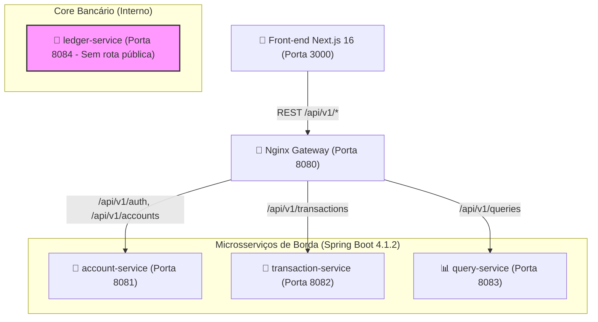
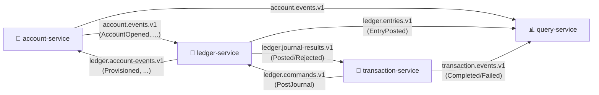

# Plano de Desenvolvimento — Ledger Bancário (Laboratório)

Plano definitivo para desenvolvimento iterativo e isolado do backend do **Bank Ledger / Nexus Bank**, com integração contínua tela a tela no frontend Next.js 16.

**Stack Base Oficial:**
- **Linguagem & Runtime:** Java 25 com suporte nativo a Virtual Threads (`spring.threads.virtual.enabled=true`).
- **Framework:** Spring Boot 4.1.2 (Spring Framework 7, Jackson 3 e starters modulares).
- **Gerenciador de Build:** Gradle 9.x com Wrapper na raiz do repositório (`./gradlew`), sintaxe padrão (Groovy DSL em `build.gradle` e `settings.gradle`), estruturado em microsserviços 100% independentes via Composite Builds (`includeBuild`).
- **API Gateway:** Nginx na porta `8080` (roteamento centralizado para os microsserviços, CORS gerenciado centralmente para `http://localhost:3000`, DNS dinâmico e endpoint nativo `/health`).
- **Persistência:** PostgreSQL 18 (`postgres:18-alpine`) na porta `5432`, usuário dedicado `bank_ledger` com o padrão *Database-per-Service* (`account_db`, `ledger_db`, `transaction_db`, `query_db`) inicializados via `/docker-entrypoint-initdb.d/init-databases.sql` e migrações gerenciadas pelo Flyway em cada serviço.
- **Mensageria & Consistência Eventual:** Apache Kafka local em modo KRaft via `confluentinc/cp-kafka:8.4.0` (1 broker, sem Zookeeper), container `kafka-init` para criação declarativa de tópicos com 3 partições, `kafka-ui` na porta `8085`, Transactional Outbox com `SKIP LOCKED` em Virtual Threads e Inbox idempotente.
- **Frontend:** Next.js 16.4.3 (App Router / TypeScript / Tailwind CSS v4) consumindo o Gateway na porta `8080`.

---

## 1. Objetivo, Escopo e Premissas

- **Objetivo:** Construir o Core Bancário do Nexus Bank praticando conceitos financeiros rigorosos (contas correntes, princípio contábil de partidas dobradas, saldo fortemente consistente, extrato auditável, limites operacionais, idempotência estrita e consistência eventual) através de microsserviços desacoplados e integrados ao frontend.
- **Escopo:** Abertura de conta, autenticação por CPF/senha (JWT), depósito, saque, transferência entre contas, consulta de saldo em tempo real e extrato oficial.
- **Fora de escopo inicial:** Pix, boletos, cartões de crédito, cheque especial, KYC externo e orquestração de Kubernetes.
- **Premissas Financeiras:** Moeda única BRL; valores estritamente inteiros em centavos (`bigint`/`long`), nunca ponto flutuante (`float`/`double`); impossibilidade matemática de saldo negativo em contas de cliente; uma conta por CPF; dados locais controlados.

---

## 2. Decisões de Arquitetura

| Tema | Decisão | Motivo |
| :--- | :--- | :--- |
| **Topologia** | Microsserviços independentes (`account`, `transaction`, `ledger`, `query`) | Garante fronteiras de domínio rígidas, escalabilidade isolada e responsabilidades claras |
| **Build & Monorepo** | Gradle independente por serviço com Composite Builds (`includeBuild`) | Permite compilar e rodar cada serviço de forma autônoma sem publicar artefatos em repositórios remotos |
| **API Gateway** | Nginx na porta `8080` | Ponto único de entrada para o Frontend, distribuindo tráfego para os microsserviços |
| **Persistência** | PostgreSQL único com bancos lógicos dedicados (*Database-per-Service*) | ACID, locks de linha seguros, constraints fortes e Flyway por serviço, sem a sobrecarga de múltiplos SGBDs |
| **Read Model (CQRS)**| Tabelas de leitura desnormalizadas no PostgreSQL (`query_db`) | Elimina complexidade operacional do MongoDB e atende perfeitamente ao extrato e saldo |
| **Mensageria** | 1 Broker Kafka em modo KRaft (sem Zookeeper), JSON com envelope versionado | Simplicidade operacional local com garantia de desacoplamento assíncrono e eventos duráveis |
| **Confiabilidade** | Transactional Outbox (`platform-commons`) + Inbox no consumidor | Elimina o risco de *dual-write* e garante entrega *at-least-once* com efeito *exactly-once* |
| **Core Ledger** | Partidas Dobradas (Double-Entry), lançamentos imutáveis e 16 shards CASH | Auditabilidade total, soma zero entre débitos e créditos, e contenção de lock diluída no Postgres |
| **Autenticação** | JWT emitido pelo `account-service` com validação nos demais serviços | Seguro, desacoplado e aderente aos padrões de mercado |
| **Arquitetura Interna**| Arquitetura Hexagonal (Ports & Adapters) com governança via ArchUnit | Regras de negócio puras desacopladas de frameworks, persistência e mensageria |

---

## 3. Topologia e Fluxos do Sistema

### 3.1 Visão Síncrona e Roteamento via Gateway (Nginx)



### 3.2 Topologia de Mensageria (Assíncrono via Kafka)



### 3.3 Fluxos de Negócio

#### Fluxo 1: Abertura e Ativação de Conta
1. O frontend envia `POST /api/v1/accounts` com nome, CPF, data de nascimento, e-mail, telefone e senha.
2. O `account-service` valida o CPF, cria o cliente e a conta com status `PENDING_ACTIVATION` e insere o evento `AccountOpened` na tabela `outbox_event`.
3. O poller outbox do `account-service` publica no tópico `account.events.v1`.
4. O `ledger-service` consome o evento e provisiona a conta contábil correspondente com saldo 0, publicando `LedgerAccountProvisioned`.
5. O `account-service` consome `LedgerAccountProvisioned` e atualiza o status da conta para `ACTIVE`.

#### Fluxo 2: Movimentações Financeiras (Depósito, Saque e Transferência)
1. O frontend envia `POST /api/v1/transactions/{deposits|withdrawals|transfers}` com o header `Idempotency-Key`.
2. O `transaction-service` valida a requisição, grava o registro de idempotência, salva a transação como `PENDING` e registra o comando `PostJournalCommand` no outbox.
3. A API responde imediatamente `202 Accepted` com `Location: /api/v1/transactions/{id}`.
4. O `ledger-service` consome o comando, aplica as regras de partidas dobradas e controle de saldo em uma transação ACID:
   - **Depósito:** Débito no shard de caixa (`SYS-CASH-nn`) e crédito na conta do cliente.
   - **Saque:** Débito na conta do cliente (se saldo suficiente) e crédito no shard de caixa.
   - **Transferência:** Débito na conta de origem e crédito na conta de destino de forma atômica.
5. O `ledger-service` grava o `journal` e as `entries`, publicando o resultado (`JournalPosted` ou `JournalRejected`) e as entradas geradas (`EntryPosted`).
6. O `transaction-service` atualiza a transação para `COMPLETED` ou `FAILED`.
7. O `query-service` consome `EntryPosted` e atualiza a projeção de extrato e saldo do cliente.

---

## 4. Modelos de Dados (PostgreSQL — Database-per-Service)

Cada microsserviço gerencia exclusivamente seu banco de dados lógico com migrações Flyway independentes.

### 4.1 Infraestrutura Comum: Tabelas de Outbox e Inbox
Presente nos bancos `account_db`, `transaction_db` e `ledger_db`:

```sql
CREATE TABLE outbox_event (
  id             uuid         NOT NULL,
  aggregate_type varchar(40)  NOT NULL,
  aggregate_id   uuid         NOT NULL,
  event_type     varchar(80)  NOT NULL,
  event_version  int          NOT NULL DEFAULT 1,
  topic          varchar(120) NOT NULL,
  message_key    varchar(64)  NOT NULL,
  payload        jsonb        NOT NULL,
  headers        jsonb        NOT NULL DEFAULT '{}'::jsonb,
  created_at     timestamptz  NOT NULL DEFAULT now(),
  published_at   timestamptz,
  attempts       int          NOT NULL DEFAULT 0,
  CONSTRAINT pk_outbox_event PRIMARY KEY (id)
);
CREATE INDEX ix_outbox_pending ON outbox_event (created_at) WHERE published_at IS NULL;

CREATE TABLE inbox_event (
  event_id     uuid         NOT NULL,
  handler      varchar(80)  NOT NULL,
  processed_at timestamptz  NOT NULL DEFAULT now(),
  CONSTRAINT pk_inbox_event PRIMARY KEY (event_id, handler)
);
```

### 4.2 Banco `account_db` (`account-service`)

```sql
CREATE SEQUENCE account_number_seq START 100000;

CREATE TABLE customer (
  id                    uuid         PRIMARY KEY,
  full_name             varchar(120) NOT NULL,
  cpf                   char(11)     NOT NULL,
  birth_date            date         NOT NULL,
  email                 varchar(254) NOT NULL,
  phone                 varchar(16)  NOT NULL,
  password_hash         varchar(100) NOT NULL,
  failed_login_attempts int          NOT NULL DEFAULT 0,
  locked_until          timestamptz,
  created_at            timestamptz  NOT NULL DEFAULT now(),
  updated_at            timestamptz  NOT NULL DEFAULT now(),
  version               bigint       NOT NULL DEFAULT 0,
  CONSTRAINT uk_customer_cpf   UNIQUE (cpf),
  CONSTRAINT uk_customer_email UNIQUE (email),
  CONSTRAINT ck_customer_cpf   CHECK (cpf ~ '^[0-9]{11}$')
);

CREATE TABLE account (
  id            uuid        PRIMARY KEY,
  customer_id   uuid        NOT NULL REFERENCES customer(id),
  agency        char(4)     NOT NULL DEFAULT '0001',
  number        varchar(10) NOT NULL,
  digit         char(1)     NOT NULL,
  type          varchar(20) NOT NULL DEFAULT 'CHECKING',
  status        varchar(24) NOT NULL,
  status_reason varchar(140),
  opened_at     timestamptz NOT NULL DEFAULT now(),
  activated_at  timestamptz,
  closed_at     timestamptz,
  version       bigint      NOT NULL DEFAULT 0,
  CONSTRAINT uk_account_agency_number UNIQUE (agency, number),
  CONSTRAINT uk_account_customer      UNIQUE (customer_id),
  CONSTRAINT ck_account_status        CHECK (status IN ('PENDING_ACTIVATION','ACTIVE','BLOCKED','CLOSED'))
);
CREATE INDEX ix_account_status ON account (status);
```

### 4.3 Banco `ledger_db` (`ledger-service`)

```sql
CREATE TABLE ledger_account (
  id             uuid        PRIMARY KEY,
  code           varchar(40) NOT NULL,
  kind           varchar(10) NOT NULL,
  normal_balance varchar(6)  NOT NULL,
  currency       char(3)     NOT NULL DEFAULT 'BRL',
  balance        bigint      NOT NULL DEFAULT 0,
  last_sequence  bigint      NOT NULL DEFAULT 0,
  status         varchar(10) NOT NULL,
  created_at     timestamptz NOT NULL DEFAULT now(),
  updated_at     timestamptz NOT NULL DEFAULT now(),
  version        bigint      NOT NULL DEFAULT 0,
  CONSTRAINT uk_ledger_account_code UNIQUE (code),
  CONSTRAINT ck_la_kind     CHECK (kind IN ('CUSTOMER','SYSTEM')),
  CONSTRAINT ck_la_normal   CHECK (normal_balance IN ('DEBIT','CREDIT')),
  CONSTRAINT ck_la_status   CHECK (status IN ('ACTIVE','BLOCKED','CLOSED')),
  CONSTRAINT ck_la_balance  CHECK (kind = 'SYSTEM' OR balance >= 0)
);

CREATE TABLE journal (
  id             uuid         PRIMARY KEY,
  transaction_id uuid         NOT NULL,
  type           varchar(16)  NOT NULL,
  status         varchar(10)  NOT NULL,
  reject_code    varchar(40),
  reject_reason  varchar(255),
  description    varchar(140),
  total_amount   bigint       NOT NULL,
  currency       char(3)      NOT NULL DEFAULT 'BRL',
  correlation_id uuid         NOT NULL,
  posted_at      timestamptz  NOT NULL DEFAULT now(),
  CONSTRAINT uk_journal_transaction UNIQUE (transaction_id),
  CONSTRAINT ck_journal_status CHECK (status IN ('POSTED','REJECTED'))
);

CREATE TABLE entry (
  id                uuid        PRIMARY KEY,
  journal_id        uuid        NOT NULL REFERENCES journal(id),
  ledger_account_id uuid        NOT NULL REFERENCES ledger_account(id),
  direction         varchar(6)  NOT NULL,
  amount            bigint      NOT NULL,
  balance_after     bigint      NOT NULL,
  sequence          bigint      NOT NULL,
  created_at        timestamptz NOT NULL DEFAULT now(),
  CONSTRAINT uk_entry_account_seq UNIQUE (ledger_account_id, sequence),
  CONSTRAINT ck_entry_direction CHECK (direction IN ('DEBIT','CREDIT')),
  CONSTRAINT ck_entry_amount    CHECK (amount > 0)
);
CREATE INDEX ix_entry_account_created ON entry (ledger_account_id, created_at DESC);

-- Seed de 16 caixas para diluição de lock
INSERT INTO ledger_account (id, code, kind, normal_balance, status)
SELECT gen_random_uuid(), 'SYS-CASH-' || lpad(n::text, 2, '0'), 'SYSTEM', 'DEBIT', 'ACTIVE'
FROM generate_series(0, 15) AS n;
```

### 4.4 Banco `transaction_db` (`transaction-service`)

```sql
CREATE TABLE financial_transaction (
  id                     uuid         PRIMARY KEY,
  type                   varchar(16)  NOT NULL,
  status                 varchar(16)  NOT NULL,
  source_account_id      uuid,
  destination_account_id uuid,
  amount                 bigint       NOT NULL,
  currency               char(3)      NOT NULL DEFAULT 'BRL',
  description            varchar(140),
  requested_by           uuid         NOT NULL,
  failure_code           varchar(40),
  failure_reason         varchar(255),
  correlation_id         uuid         NOT NULL,
  created_at             timestamptz  NOT NULL DEFAULT now(),
  updated_at             timestamptz  NOT NULL DEFAULT now(),
  completed_at           timestamptz,
  version                bigint       NOT NULL DEFAULT 0,
  CONSTRAINT ck_tx_type   CHECK (type IN ('DEPOSIT','WITHDRAWAL','TRANSFER')),
  CONSTRAINT ck_tx_status CHECK (status IN ('PENDING','COMPLETED','FAILED')),
  CONSTRAINT ck_tx_amount CHECK (amount > 0)
);
CREATE INDEX ix_tx_source_created ON financial_transaction (source_account_id, created_at DESC);
CREATE INDEX ix_tx_pending        ON financial_transaction (created_at) WHERE status = 'PENDING';

CREATE TABLE idempotency_key (
  scope           uuid        NOT NULL,
  idem_key        uuid        NOT NULL,
  endpoint        varchar(40) NOT NULL,
  request_hash    char(64)    NOT NULL,
  status          varchar(16) NOT NULL,
  transaction_id  uuid,
  response_status int,
  response_body   jsonb,
  created_at      timestamptz NOT NULL DEFAULT now(),
  expires_at      timestamptz NOT NULL,
  CONSTRAINT pk_idempotency_key PRIMARY KEY (scope, idem_key),
  CONSTRAINT ck_idem_status CHECK (status IN ('IN_PROGRESS','COMPLETED'))
);
CREATE INDEX ix_idem_expires ON idempotency_key (expires_at);
```

### 4.5 Banco `query_db` (`query-service`)

```sql
CREATE TABLE account_balance (
  account_id    uuid        PRIMARY KEY,
  balance       bigint      NOT NULL DEFAULT 0,
  currency      char(3)     NOT NULL DEFAULT 'BRL',
  last_sequence bigint      NOT NULL DEFAULT 0,
  updated_at    timestamptz NOT NULL DEFAULT now()
);

CREATE TABLE statement_entry (
  id                            uuid         PRIMARY KEY,
  account_id                    uuid         NOT NULL,
  sequence                      bigint       NOT NULL,
  journal_id                    uuid         NOT NULL,
  transaction_id                uuid         NOT NULL,
  category                      varchar(20)  NOT NULL,
  type                          varchar(20)  NOT NULL,
  direction                     varchar(6)   NOT NULL,
  amount                        bigint       NOT NULL,
  balance_after                 bigint       NOT NULL,
  counterparty_name             varchar(120),
  counterparty_document_masked  varchar(20),
  counterparty_account          varchar(20),
  description                   varchar(140),
  idempotency_key               varchar(64),
  failure_reason                varchar(255),
  posted_at                     timestamptz  NOT NULL,
  CONSTRAINT uk_statement_account_seq UNIQUE (account_id, sequence)
);
CREATE INDEX ix_statement_account_posted ON statement_entry (account_id, posted_at DESC);

CREATE TABLE account_directory (
  account_id         uuid         PRIMARY KEY,
  agency             char(4)      NOT NULL,
  number             varchar(10)  NOT NULL,
  digit              char(1)      NOT NULL,
  holder_name_masked varchar(120) NOT NULL,
  status             varchar(20)  NOT NULL,
  CONSTRAINT uk_directory_agency_number UNIQUE (agency, number)
);
```

---

## 5. Gateway e Contratos REST

O frontend se comunica unicamente com a porta `8080` (Nginx Gateway), sob o prefixo `/api/v1`.

### 5.1 Roteamento Nginx (`infra/docker/nginx/nginx.conf`)
- `/api/v1/auth/*` → `account-service:8081`
- `/api/v1/accounts/*` → `account-service:8081`
- `/api/v1/transactions/*` → `transaction-service:8082`
- `/api/v1/queries/*` → `query-service:8083`

### 5.2 Catálogo de Endpoints

| Serviço | Método | Rota no Gateway | Descrição | Status HTTP |
| :--- | :--- | :--- | :--- | :--- |
| `account` | `POST` | `/api/v1/accounts` | Abertura de conta corrente digital | `201 Created` |
| `account` | `POST` | `/api/v1/auth/login` | Autenticação por CPF e Senha | `200 OK` (retorna JWT) |
| `account` | `GET` | `/api/v1/accounts/me` | Dados cadastrais do titular logado | `200 OK` |
| `account` | `GET` | `/api/v1/accounts/lookup?agency=&number=` | Busca de destinatário mascarado | `200 OK` |
| `transaction` | `POST` | `/api/v1/transactions/deposits` | Intenção de depósito | `202 Accepted` |
| `transaction` | `POST` | `/api/v1/transactions/withdrawals` | Intenção de saque | `202 Accepted` |
| `transaction` | `POST` | `/api/v1/transactions/transfers` | Transferência entre contas | `202 Accepted` |
| `transaction` | `GET` | `/api/v1/transactions/{id}` | Consulta de status do protocolo | `200 OK` |
| `query` | `GET` | `/api/v1/queries/accounts/{id}/balance` | Saldo disponível e limites | `200 OK` |
| `query` | `GET` | `/api/v1/queries/accounts/{id}/statement` | Extrato histórico paginado | `200 OK` |

---

## 6. Práticas de Engenharia e Estrutura de Código

### 6.1 Estrutura Canônica Hexagonal (por Microsserviço)

Cada serviço terá seu próprio projeto Gradle com estrutura rigorosamente desacoplada:

```text
services/<nome-servico>/
├── build.gradle                 # Groovy DSL padrão Java
├── settings.gradle              # Composite build: includeBuild('../../platform-commons')
└── src/
    ├── main/
    │   ├── java/com/bankledger/<servico>/
    │   │   ├── domain/          # Modelos ricos, VOs, Invariantes e Exceções (SEM SPRING)
    │   │   ├── application/     # Casos de uso e Portas in/out
    │   │   ├── adapters/        # Adaptadores REST, Kafka e Persistência JPA
    │   │   └── config/          # Beans, Security e DI
    │   └── resources/
    │       ├── application.yml  # Configurações do Spring Boot 4.1.2
    │       └── db/migration/    # Scripts Flyway
    └── test/                    # Testes unitários, de arquitetura (ArchUnit) e integração
```

### 6.2 Governança com ArchUnit
Cada serviço terá um teste automatizado de governança arquitetural que falha o build caso:
1. O pacote `domain` faça imports de `org.springframework.*`, `jakarta.persistence.*` ou anotações externas.
2. Adaptadores sejam acessados diretamente pela camada de aplicação.

---

## 7. Roteiro de Execução em 4 Slices Verticais

O desenvolvimento é conduzido de forma estritamente incremental, integrando e validando cada tela no frontend antes de iniciar o próximo serviço.

### 🧱 Slice 0 — Fundação e Infraestrutura Base
- **Objetivo:** Estabelecer o ambiente de execução local com Docker Compose (Postgres 18, Confluent cp-kafka KRaft, Nginx Gateway com CORS e Kafka UI) e a biblioteca de mensageria compartilhada (`platform-commons`) com governança e testes isolados.
- **Entregas:**
  1. `infra/docker/docker-compose.yml`:
     - PostgreSQL 18 (`postgres:18-alpine` na porta 5432) com script `init-databases.sql` criando `account_db`, `ledger_db`, `transaction_db`, `query_db` com o usuário `bank_ledger`.
     - Apache Kafka em modo KRaft com `confluentinc/cp-kafka:8.4.0` (porta 9092 no host e 29092 interna).
     - Container efêmero `kafka-init` para criar previamente os 6 tópicos do sistema (`account.events.v1`, `ledger.commands.v1`, `ledger.journal-results.v1`, `ledger.account-events.v1`, `ledger.entries.v1`, `transaction.events.v1`) com 3 partições.
     - `kafka-ui` (`provectuslabs/kafka-ui:latest`) na porta 8085 para observabilidade em tempo de desenvolvimento.
     - Nginx Gateway configurado na porta 8080 com CORS centralizado para `http://localhost:3000`, resolução de DNS dinâmica (`resolver 127.0.0.11`) e rota nativa `/health` retornando 200 OK.
     - Healthchecks com ordenação por dependência (`condition: service_healthy`) em todos os containers.
  2. Monorepo & Gradle:
     - Gradle Wrapper na raiz do monorepo (`./gradlew`) compatível com Java 25.
     - `settings.gradle` na raiz com Composite Build (`includeBuild('platform-commons')`).
  3. `platform-commons`:
     - Projeto Gradle Groovy compartilhável sobre Java 25 e Spring Boot 4.1.2.
     - Pacote de Domínio Puro (`com.bankledger.commons.domain.event`): Records imutáveis `EventEnvelope<T>` e `EventMetadata` alinhados a CloudEvents, com serialização Jackson 3 em ISO-8601 UTC.
     - Pacote de Infraestrutura (`com.bankledger.commons.outbox` e `inbox`):
       - Entidade JPA e repositório de `OutboxEvent` com busca `FOR UPDATE SKIP LOCKED`.
       - Poller do outbox executando sobre Virtual Threads com lote delimitado (50), delay configurável e controle de tentativas (`attempts`).
       - Entidade JPA de `InboxEvent` e helper transacional `InboxHandler` para garantir efeito *exactly-once* nos consumidores.
     - Script canônico DDL `schema/outbox-inbox-schema.sql` para testes e referência dos microsserviços.
     - Suíte de testes automatizados unitários e de integração utilizando **Testcontainers** (PostgreSQL efêmero).
- **Critério de Pronto:**
  1. `docker compose up` sobe PostgreSQL 18, Kafka KRaft, `kafka-ui` e Nginx Gateway com status saudável (`healthy`).
  2. Chamada `GET http://localhost:8080/health` responde HTTP `200 OK`.
  3. `./gradlew test` executa com sucesso todos os testes de `platform-commons` via Testcontainers.

---

### 👤 Slice 1 — Identidade & Gestão de Contas (`account-service`)
- **Objetivo:** Permitir que o usuário se cadastre e realize login real no sistema, integrando o frontend.
- **Telas Integradas:**
  - `/signup` (Abertura de conta guiada em 3 etapas).
  - `/login` (Autenticação com CPF e senha eletrônica).
  - `/dashboard` (Exibição dos dados do titular autenticado).
- **Entregas Backend (`services/account-service`):**
  - Domínio: Entidades `Customer`, `Account`, Value Objects (`Cpf`, `AccountNumber`).
  - Casos de Uso: `CreateAccountUseCase`, `LoginUseCase`, `GetAccountMeUseCase`, `LookupAccountUseCase`.
  - Adaptadores: Controllers REST, migrações Flyway `V1`, publicação de evento `AccountOpened` no Outbox.
  - Segurança: Emissão de token JWT com tempo de expiração e hashing BCrypt para senhas.
- **Validação de Integração:**
  - Criar conta pelo formulário do `/signup` e verificar registro no banco `account_db`.
  - Fazer login no `/login` com o CPF cadastrado, receber o token JWT e ser redirecionado para o dashboard com o nome do cliente renderizado.

---

### 🏦 Slice 2 — Core Ledger & Operações Básicas (`ledger-service` + `transaction-service`)
- **Objetivo:** Estabelecer a fonte da verdade financeira (Partidas Dobradas) e viabilizar depósitos e saques com idempotência.
- **Telas Integradas:**
  - `/dashboard/operacoes` (Abas de Depósito e Saque).
- **Entregas Backend:**
  - `ledger-service`:
    - Provisionamento contábil consumindo `AccountOpened`.
    - Inicialização dos 16 shards `SYS-CASH`.
    - Execução atômica do `PostJournalCommand` para depósito e saque com cálculo e validação estrita de saldo.
    - Publicação de `JournalPosted` e `EntryPosted`.
  - `transaction-service`:
    - Endpoints `/api/v1/transactions/deposits` e `/api/v1/transactions/withdrawals`.
    - Validação de idempotência HTTP via `Idempotency-Key`.
    - Emissão do comando assíncrono para o Kafka e atualização de status para `COMPLETED`.
- **Validação de Integração:**
  - Realizar um depósito de R$ 500 no front e confirmar o status 202 com resolução para COMPLETED.
  - Realizar um saque e validar a rejeição caso o valor solicitado seja superior ao saldo disponível.

---

### 💸 Slice 3 — Transferência entre Contas (`transaction-service` + `ledger-service`)
- **Objetivo:** Implementar a transferência atômica entre duas contas correntes distintas, respeitando limites e integridade contábil.
- **Telas Integradas:**
  - `/dashboard/transferir` (Lookup de contraparte mascarada e confirmação de transferência).
- **Entregas Backend:**
  - Endpoint de lookup no `account-service` (`GET /api/v1/accounts/lookup?agency=&number=`).
  - Endpoint `POST /api/v1/transactions/transfers` no `transaction-service`.
  - Lançamento contábil atômico no `ledger-service` debitando a conta origem e creditando a conta destino na mesma transação.
  - Garantia de que a soma dos débitos seja exatamente igual à soma dos créditos (trial balance zero).
- **Validação de Integração:**
  - Buscar conta destino pelo número e agência no front, verificando o nome mascarado retornado.
  - Executar a transferência e confirmar o débito na conta de origem e crédito na conta de destino.

---

### 📊 Slice 4 — Extrato Oficial & Projeções CQRS (`query-service`)
- **Objetivo:** Materializar o lado de leitura do CQRS, permitindo consultar o extrato completo e o saldo com alta performance.
- **Telas Integradas:**
  - `/dashboard/extrato` (Histórico com filtros por período e comprovante).
  - `/dashboard` (Card de saldo e métricas em tempo real).
- **Entregas Backend (`services/query-service`):**
  - Consumidores Kafka para `AccountOpened`, `EntryPosted` e `TransactionCompleted`.
  - Atualização determinística da tabela `account_balance` e inserção ordenada na `statement_entry` com controle de sequência (`sequence == lastSequence + 1`).
  - Endpoints REST de extrato com filtros (`/statement`) e saldo (`/balance`).
- **Validação de Integração:**
  - Desativar 100% o modo mock no frontend (`NEXT_PUBLIC_USE_MOCK=false`).
  - Acessar o extrato no navegador e verificar todas as movimentações reais realizadas nos Slices anteriores com paginação e comprovantes operacionais.

---

## 8. Critérios de Sucesso e Validação Final

1. **Jornada do Cliente 100% Real:** O usuário é capaz de abrir conta, logar, depositar, sacar, transferir e auditar seu extrato pelo frontend sem nenhum mock ativo.
2. **Invariantes Contábeis Respeitados:**
   - $\sum \text{Débitos} - \sum \text{Créditos} = 0$ em todas as entradas do ledger.
   - Nenhum saldo de cliente negativo.
   - Reexecução com a mesma `Idempotency-Key` não duplica movimentações financeiras.
3. **Isolamento de Microsserviços:** Cada serviço possui seu próprio `build.gradle`, seu próprio banco no Postgres e sua suíte de testes unitários e de integração independentes.
