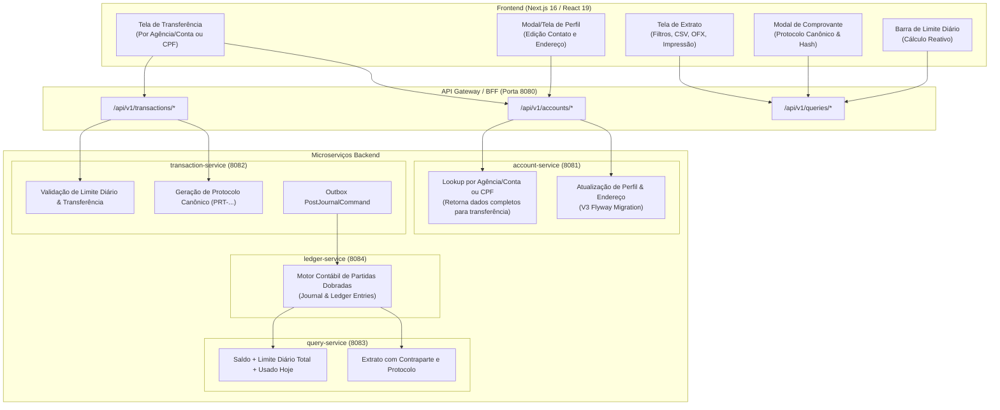

# Especificação Técnica e Arquitetural: Regras de Negócio e Gestão de Perfil

**Data:** 17 de Novembro de 2026  
**Status:** Aprovado para Planejamento e Execução  
**Branch:** `feature/business-rules-overhaul`  
**Escopo:** Backend (Microserviços Spring Boot / PostgreSQL / Kafka) e Frontend (Next.js 16 / React 19 / Tailwind v4)

---

## 1. Visão Geral e Objetivos do Negócio

Esta especificação define a evolução arquitetural do **Nexus Bank Ledger** para suportar operações bancárias completas de alta fidelidade regulatória e excelente usabilidade financeira.

### Principais Objetivos:
1. **Governança de Limite Diário de Transferências:**
   - Computação e validação rígida de limites diários no backend.
   - Projeção do limite utilizado e disponível em tempo real no frontend, com barra de progresso reativa e bloqueio de transferências excedentes.
2. **Extrato Bancário Humanizado e Detalhado:**
   - Tipos de transação canônicos e descrições ricas em língua portuguesa (`Transferência enviada`, `Transferência recebida`, `Depósito em conta corrente`, `Saque terminal`).
   - Identificação transparente de origem e destino (contraparte).
3. **Comprovantes Canônicos e Protocolo de Auditoria Bancária:**
   - Geração de protocolo único canônico de auditoria no backend (`PRT-YYYYMMDD-XXXXX`).
   - Modal de comprovante com dados fidedignos de pagador/origem e favorecido/destino, data/hora e autenticação eletrônica (hash criptográfico).
4. **Ações Operacionais de Relatórios e Impressão:**
   - Botão **Imprimir Comprovante** 100% funcional via folha de estilo de impressão limpa (`@media print`).
   - Botão **Comprovante Consolidado** funcional, gerando resumo patrimonial do período selecionado.
   - Botão **Exportar Relatório** funcional suportando formatos CSV e OFX (Open Financial Exchange para contabilidade).
5. **Gestão de Perfil e Cadastro de Endereço:**
   - Persistência e governança de endereço completo no backend (`logradouro`, `número`, `complemento`, `bairro`, `cidade`, `UF`, `CEP`).
   - Interface de edição de perfil e endereço no frontend com busca e autopreenchimento de CEP.
6. **Desmascaramento de Dados do Destinatário na Transferência:**
   - Exibição de dados completos do favorecido (Nome e CPF completo / formatado) após verificação antes de confirmar o envio.
7. **Transferência por CPF:**
   - Suporte completo a busca de conta e transferência bancária informando apenas o CPF do favorecido.

---

## 2. Arquitetura da Solução



---

## 3. Especificação Detalhada por Módulo

### 3.1. Limite Diário de Transferências

#### Regra de Negócio:
- Cada conta possui um limite diário de transferências (padrão: R$ 50.000,00 ou parametrizável na entidade `Account`).
- O total utilizado no dia (`usedTodayCents`) é o somatório de todas as saídas de transferência (`TRANSFER`, direção `DEBIT`) postadas no dia corrente (fuso horário local UTC-3 / dia civil).
- O limite disponível é `availableLimitCents = max(0, dailyLimitCents - usedTodayCents)`.
- **Backend:**
  - `query-service`: O endpoint `GET /api/v1/queries/accounts/{id}/balance` calcula dinamicamente `usedTodayCents` consultando os lançamentos de débito do dia em `statement_entry`.
  - `transaction-service`: O serviço `CreateTransferService` valida se `amountCents <= remainingDailyLimit` antes de aceitar a transação, rejeitando com HTTP 422 caso exceda o limite.
- **Frontend:**
  - Exibe no topo do dashboard e na tela de transferência:
    - Limite Total Diário: `R$ 50.000,00`
    - Limite Utilizado Hoje: `R$ X,XX`
    - Limite Disponível Restante: `R$ Y,YY`
  - Na tela de transferência, enquanto o usuário digita o valor, uma barra de progresso visual interativa atualiza em tempo real:
    - Verde (< 70% do limite consumido)
    - Amarelo / Âmbar (70% a 90%)
    - Vermelho (> 90% ou excedente)
  - Desabilita o botão "Confirmar Transferência" se o valor informado ultrapassar o limite disponível, exibindo aviso claro: *"O valor informado (R$ X,XX) ultrapassa o limite diário disponível (R$ Y,YY)."*

---

### 3.2. Transferência por CPF e Lookup Desmascarado

#### Regra de Negócio:
- Na tela de transferência, o usuário pode alternar entre duas modalidades:
  1. **Por Agência e Conta:** Digita agência e número de conta com dígito.
  2. **Por CPF:** Digita o CPF do destinatário com formatação automática (`000.000.000-00`).
- Ao completar o preenchimento (ou clicar em "Verificar Destinatário"), o frontend invoca o endpoint de lookup:
  - `GET /api/v1/accounts/lookup?agency=...&number=...` OU `GET /api/v1/accounts/lookup?cpf=...`
- O backend responde com a nova estrutura enriquecida:
  ```json
  {
    "accountId": "a3b4c5d6-...",
    "branch": "0001",
    "accountNumber": "100000",
    "checkDigit": "4",
    "holderName": "Carlos Eduardo Silva",
    "cpf": "529.982.247-25",
    "bankCode": "001",
    "bankName": "Nexus Bank S.A."
  }
  ```
- No frontend, o cartão de confirmação exibe os dados reais do titular sem mascaramento para conferência segura antes de o usuário digitar a senha ou autenticar.

---

### 3.3. Extrato Bancário Humanizado e Dados da Contraparte

#### Regra de Negócio:
- Os tipos técnicos (`DEPOSIT`, `WITHDRAWAL`, `TRANSFER_OUT`, `TRANSFER_IN`, `FEE`, `REVERSAL`) são traduzidos de forma amigável em toda a aplicação:
  - `TRANSFER_OUT`: **Transferência enviada**
  - `TRANSFER_IN`: **Transferência recebida**
  - `DEPOSIT`: **Depósito em conta corrente**
  - `WITHDRAWAL`: **Saque em terminal**
  - `PIX_TRANSFER`: **Transferência Pix**
- Cada item de extrato deve carregar:
  - `protocolNumber`: Identificador de protocolo oficial (`PRT-YYYYMMDD-XXXXXX`).
  - `direction`: `DEBIT` (-) ou `CREDIT` (+).
  - `counterpartyName`: Nome completo do favorecido/origem.
  - `counterpartyDocument`: CPF formatado da contraparte.
  - `counterpartyAccount`: Agência e Conta da contraparte (`Ag: 0001 | Cc: 100002-3`).
  - `amountCents` e `balanceAfterCents`: Valores exatos em centavos.
  - `postedAt`: Data e hora exatas com fuso brasileiro.

---

### 3.4. Comprovante Canônico e Auditoria

#### Regra de Negócio:
- Ao clicar em "Comprovante" em qualquer lançamento do extrato, abre-se um modal dedicado formatado como Comprovante Bancário Oficial:
  1. Cabeçalho institucional: Logotipo e dados do Nexus Bank (Banco 001 - ISPB 00000000).
  2. Protocolo de Transação: `PRT-20261117-9F8A2D`.
  3. Informações da Operação: Tipo, Valor (R$), Data e Hora de Liquidação Contábil.
  4. Dados do Pagador (Origem): Nome completo, CPF, Agência e Conta.
  5. Dados do Favorecido (Destino): Nome completo, CPF, Agência e Conta, Instituição.
  6. Autenticação Eletrônica Bancária: Código hash SHA-256 canônico gerado a partir de `protocolNumber + transactionId + timestamp + amount`.
- **Ação de Impressão:**
  - Botão "Imprimir Comprovante": Dispara `window.print()` estilizado com classe `@media print`, ocultando sidebars, botões e modais externos, imprimindo exclusivamente a folha do comprovante em formato A4 limpo.

---

### 3.5. Comprovante Consolidado e Exportação de Relatórios

#### Regra de Negócio:
1. **Comprovante Consolidado:**
   - O botão "Comprovante Consolidado" na tela de extrato abre um modal com o demonstrativo contábil do período:
     - Período avaliado (Ex: 01/11/2026 a 30/11/2026).
     - Total de Entradas / Créditos (+)
     - Total de Saídas / Débitos (-)
     - Saldo Inicial e Saldo Final do Período.
     - Tabela sintética consolidada das operações.
     - Botão para imprimir diretamente o relatório consolidado.
2. **Exportação de Relatório (CSV e OFX):**
   - **CSV:** Gera arquivo `.csv` codificado em UTF-8 com BOM, delimitador `;` compatível com Excel brasileiro:
     `Data;Protocolo;Tipo;Descrição;Contraparte;Documento;Agência/Conta;Natureza;Valor (R$);Saldo (R$)`
   - **OFX (Open Financial Exchange):** Gera arquivo `.ofx` padrão bancário para importação direta em softwares contábeis (ContaAzul, QuickBooks, etc.).

---

### 3.6. Gestão de Perfil de Usuário e Endereço

#### Regra de Negócio:
- Os clientes do banco podem consultar seus dados cadastrais e atualizar seus dados de contato e endereço residencial/comercial.
- **Campos Imutáveis pelo Cliente:**
  - Nome Completo, CPF, Data de Nascimento, Agência e Número de Conta.
- **Campos Editáveis:**
  - Telefone celular (`phone`).
  - E-mail (`email`).
  - Endereço Completo:
    - CEP (`postalCode`): 8 dígitos formatados `00000-000`.
    - Logradouro (`street`): Ex: Avenida Paulista.
    - Número (`number`): Ex: 1000.
    - Complemento (`complement`): Ex: Apto 42, Bloco B.
    - Bairro (`neighborhood`): Ex: Bela Vista.
    - Cidade (`city`): Ex: São Paulo.
    - Estado / UF (`state`): Ex: SP (2 letras maiúsculas).
- **Backend:**
  - Tabela `customer` recebe colunas via migration Flyway `V3__add_customer_address.sql`.
  - Endpoint `PUT /api/v1/accounts/me/profile` atualiza os dados com validação.
  - Endpoint `GET /api/v1/accounts/me` retorna os dados cadastrais completos.
- **Frontend:**
  - Modal ou página dedicada "Meu Perfil" acessível pelo avatar do usuário ou menu.
  - Preenchimento inteligente com busca de CEP integrada (com preenchimento automático de logradouro, bairro, cidade e estado).
  - Feedback visual de salvamento com toast notification.

---

## 4. Matriz de Contratos de API

| Microserviço | Método | Rota | Descrição |
| :--- | :--- | :--- | :--- |
| `account-service` | `GET` | `/api/v1/accounts/me` | Retorna dados da conta, cliente e endereço completo |
| `account-service` | `PUT` | `/api/v1/accounts/me/profile` | Atualiza telefone, e-mail e endereço residencial |
| `account-service` | `GET` | `/api/v1/accounts/lookup` | Busca conta por `agency` + `number` OU por `cpf`, retornando favorecido desmascarado |
| `transaction-service` | `POST` | `/api/v1/transactions/transfers` | Executa transferência validando limite diário restante e gerando protocolo bancário |
| `query-service` | `GET` | `/api/v1/queries/accounts/{id}/balance` | Retorna saldo atual, limite diário total e limite usado hoje |
| `query-service` | `GET` | `/api/v1/queries/accounts/{id}/statement` | Retorna extrato com protocolo bancário e dados de contraparte |
