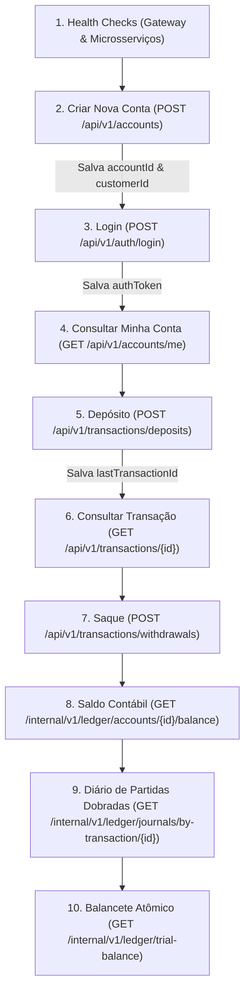

# Bank Ledger — Postman API Collection & Environment

Esta pasta contém a **Collection** e o **Environment** oficiais do Postman para testes manuais, pontuais e end-to-end das APIs do ecossistema bancário **Bank Ledger**.

---

## 📂 Arquivos Disponíveis

| Arquivo | Descrição |
| :--- | :--- |
| [`Bank-Ledger-API.postman_collection.json`](./Bank-Ledger-API.postman_collection.json) | Collection Postman v2.1.0 contendo todos os endpoints organizados por serviço. |
| [`Bank-Ledger-Local.postman_environment.json`](./Bank-Ledger-Local.postman_environment.json) | Variáveis de ambiente locais (URLs, credenciais de teste, tokens e identificadores). |

---

## 🚀 Como Importar no Postman

1. Abra o **Postman**.
2. Clique no botão **Import** (canto superior esquerdo).
3. Selecione ou arraste os arquivos:
   - `Bank-Ledger-API.postman_collection.json`
   - `Bank-Ledger-Local.postman_environment.json`
4. No canto superior direito do Postman, selecione o ambiente **Bank Ledger - Local Environment**.

---

## 🔄 Fluxo Recomendado de Teste Pontual (Happy Path)

A coleção foi configurada com scripts de teste automáticos que capturam IDs e tokens das respostas e populam as variáveis automaticamente:

### 1. Criar Nova Conta
- **Endpoint:** `POST {{gatewayUrl}}/api/v1/accounts`
- **Ação:** Cria o cliente e abre a conta bancária.
- **Automação:** O Postman salva automaticamente `accountId`, `customerId`, `agency` e `accountNumber`.

### 2. Login
- **Endpoint:** `POST {{gatewayUrl}}/api/v1/auth/login`
- **Ação:** Gera o token JWT para o CPF e senha cadastrados.
- **Automação:** O token é salvo na variável `authToken` e reutilizado automaticamente em todas as requisições autenticadas.

### 3. Depósito
- **Endpoint:** `POST {{gatewayUrl}}/api/v1/transactions/deposits`
- **Cabeçalhos:** `Idempotency-Key: {{$guid}}` (Postman gera um UUID v4 dinâmico a cada disparo).
- **Corpo:** Valor em centavos (`amount: 150000` = R$ 1.500,00).
- **Automação:** O `transactionId` gerado é salvo na variável `lastTransactionId`.

### 4. Saque
- **Endpoint:** `POST {{gatewayUrl}}/api/v1/transactions/withdrawals`
- **Cabeçalhos:** `Idempotency-Key: {{$guid}}`.
- **Corpo:** Valor em centavos (`amount: 35000` = R$ 350,00).

### 5. Auditoria Contábil (ledger-service direto na porta 8084)
- **Balancete Atômico:** `GET {{ledgerServiceUrl}}/internal/v1/ledger/trial-balance`
  - Deve retornar `difference: 0` (invariante contábil de partidas dobradas).
- **Diário Contábil:** `GET {{ledgerServiceUrl}}/internal/v1/ledger/journals/by-transaction/{{lastTransactionId}}`
  - Retorna as pernas de débito e crédito balanceadas da transação.

---

## 🛠️ Portas dos Serviços Locais

- **API Gateway (Nginx):** `http://localhost:8080`
- **Account Service:** `http://localhost:8081`
- **Transaction Service:** `http://localhost:8082`
- **Query Service:** `http://localhost:8083`
- **Ledger Service:** `http://localhost:8084`
